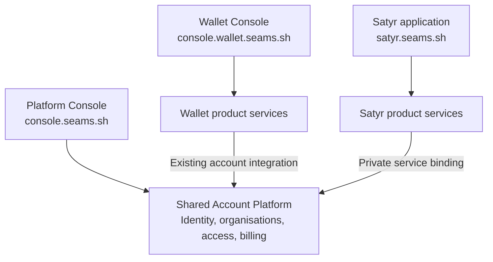

# Platform-owned Console implementation plan

Status: separate consoles and target domains agreed; implementation has not started.
Date: October 14, 2026.

## Outcome

Create a focused Platform Console and retain the separate Wallet developer Console.
Satyr keeps its own application. All three use the shared account platform.
Preserve current account, permission, billing, and product behaviour throughout the change.

| Domain | Experience | Frontend owner |
| --- | --- | --- |
| `console.seams.sh` | Organisations, projects, members, account settings, billing, service enablement | `seams-monorepo/apps/console` |
| `console.wallet.seams.sh` | Wallet environments, API keys, sponsorship, and operations | `seams-monorepo/apps/wallet-console` |
| `satyr.seams.sh` | Agents, Cases, workflows, and integrations | Existing Satyr application in the `satyr` repository |

These are the agreed target domains. They do not describe the current deployment.
The current production Console configuration uses `wallet.seams.sh`.
Keep Wallet marketing at `wallet.seams.sh`, the Wallet API at
`api.wallet.seams.sh`, and hosted Wallet signing at `sign.seams.sh`.



The diagram shows ownership and integration. It does not add account calls to
Wallet signing or require another deployed backend service.

Keep the three repositories:

- `seams-monorepo` owns Platform, its Console, and hosted product integration.
- `seams-wallet` owns public Wallet technology and its independently released packages.
- `satyr` owns the Agents product and its native operational interface.

This plan builds on [Shared Account Platform](feat-1-shared-account-platform.md).
It does not repeat the completed account, billing, service-instance, or private
Satyr binding work. Keep existing package names where their ownership is already clear.

## Scope and constraints

- Work on `dev` in the main checkout. Commit each completed phase separately.
- Preserve current public URLs, cookies, and OAuth callbacks during structural
  extraction. Change Console and Satyr application origins only in the explicit
  domain cutover phase. Preserve Worker names, binding names, D1 identities,
  Wallet signing origins, passkey relying-party IDs, and persisted record formats.
- Add zero database calls or service calls to Wallet registration, unlock, signing,
  and response paths. Add no serial validation, awaited billing delivery, or schema
  setup to these paths. Preserve existing early dispatch and query budgets.
- Reuse existing handlers, account factories, permission checks, D1 transactions,
  and asynchronous provisioning and billing delivery.
- Remove replaced source paths and exports in the same phase. Update their callers.
  Do not add compatibility barrels, duplicate entrypoints, or legacy flags.
- Use explicit product imports and routes. Do not create a plugin framework,
  service registry, dependency container, or new configuration manifest.
- Keep shared packages free of Wallet imports. Existing boundary checks remain in force.
- Keep service-native data and permissions in their owning products. Platform
  membership does not bypass Satyr's native access restrictions.
- Do not introduce another runtime service or database solely for source ownership.
- Keep `apps/wallet-console`. Extract shared account pages into `apps/console`.
  Do not rename the Wallet application into the Platform application.
- Do not rename the GitHub repository or take over the separate production Wallet
  rollout. Domain deployment is a distinct phase after structural validation.

The previously committed service-binding changes and architecture fixes still
require their own deployment coordination. Record their actual rollout state
before any deployment under this plan.

## Current code and remaining coupling

| Area | Current owner | Required change |
| --- | --- | --- |
| Console frontend | `apps/wallet-console` | Retain the Wallet app and extract a focused `apps/console` for shared account pages. |
| Shared frontend | `src/core/dashboard`, `src/app` inside the Wallet app | Move shared account pages into Platform; retain each application's own shell and navigation. |
| Wallet frontend | Existing `src/products/wallet` plus mixed routes and assets | Consolidate Wallet-specific pages in the existing product module. |
| Shared account and billing | `packages/console-server-ts`, `packages/console-shared-ts` | Keep these owners and their existing factories. |
| Hosted Console composition | `packages/wallet-console-server-ts/src/router/consoleComposition.ts` and `router/cloudflare/d1ConsoleServices.ts` | Move application assembly into the Platform application. Retain Wallet implementations in their package. |
| Production Console Worker | `packages/wallet-console-server-ts/src/router/cloudflare/d1ConsoleStagingWorker.ts` | Move the deployed entrypoint into the Platform application. |
| Private Satyr entrypoint | `packages/wallet-console-server-ts/src/router/cloudflare/satyrAccountPlatform.ts` | Move into Platform-owned composition without changing its binding contract. |
| Console deployment | `deployment/console`, `scripts/deploy-backend.mjs`, Console workflows | Preserve targets; remove unnecessary dependence on Wallet deployment configuration. |
| Frontend delivery | Console build also includes marketing, showcase, and `wallet-host` assets | Give each existing surface an explicit owner and build output. |

The account-only D1 bundle already exists. Shared packages already reject Wallet
imports. Project and service lifecycles already have separate contracts. Verify
these properties and use them; do not build parallel implementations.

## Target ownership

```text
seams-monorepo/
  apps/
    console/
      src/
        app/                 Platform shell and account routes
        core/                Organisations, projects, members, billing, services
      worker/                Existing Console backend and service composition
    wallet-console/
      src/
        app/                 Wallet developer shell and routes
        products/wallet/     Wallet management pages
    seams-site/              Company website
  packages/
    console-server-ts/       Shared account and billing implementation
    console-shared-ts/       Shared contracts and parsers
    wallet-console-server-ts/   Hosted Wallet adapters and product routes
    wallet-console-shared-ts/   Wallet management contracts
  deployment/console/        Console targets and configuration
  tests/                     Private composed acceptance tests

satyr/
  apps/portal/               Satyr product interface
  services/platform/         Satyr runtime and Account Platform client
```

Platform owns organisation and project administration, account onboarding, members,
account settings, consolidated billing, and service enablement. Wallet owns its
navigation, environments, credentials, sponsorship policy, and operational pages.
Satyr retains its portal, Cases, workflows, commerce integrations, and agent execution.

Wallet and Satyr link to Platform for shared account settings and billing. Platform
links to the product consoles. A small product switcher can carry organisation and
project identifiers, with access checked by the destination using existing mechanisms.
Identifiers in a URL select context; they do not grant access.

Use one canonical shared account page for each operation. Remove moved pages from
the Wallet application. Reuse existing UI primitives where useful, without forcing
both applications through a universal shell or creating a new design-system project.
Classify audit, webhooks, and observability by their contracts. Shared infrastructure
can remain shared while Wallet event definitions stay in Wallet.

Application-level backend composition may import both shared and product packages.
Shared packages must not import either application or product packages. Product
adapters may consume shared contracts and narrow service interfaces.

Separate frontend domains can use the existing Console backend. Prefer routing each
Console's API paths to that existing Worker at the edge, preserving same-origin
browser requests without a new application proxy hop. Keep each surface's allowed
routes and existing authentication checks explicit. Satyr retains its native backend
and uses the private Account Platform binding.

Shared account identity does not imply shared browser cookies. Preserve the existing
authentication mechanisms. Validate session behaviour across the target origins
before cutover. Do not broaden cookies to `.seams.sh`, pass session tokens in URLs,
or introduce a new single-sign-on protocol as part of the file extraction.

## Phase 1 — Inventory and baseline

1. Map active frontend entrypoints, route assembly, backend composition, bindings,
   build outputs, and deployment scripts. Distinguish active code from obsolete copies.
2. Assign each mixed page, factory, and deployment input to Platform or a product.
   Record a source-to-destination table for files that need to move.
3. Trace shared account requests through the deployed Worker. Identify any eager
   Wallet setup, product configuration parsing, or product availability dependency.
4. Capture current E2E results and per-operation database and service-call counts.
   Include registration context, active-lineage resolution, Wallet settlement,
   shared onboarding, and Satyr account access.
5. Identify browser journeys for both Console shells and navigation between products.
   Inventory origin-bound sessions, OAuth callbacks, invitation links, and return URLs.
   Extend existing journeys only for behaviour they do not cover.

Exit: the ownership table, affected commands, deployment prerequisites, and baseline
artifacts are recorded. Each proposed extraction removes a demonstrated dependency.

## Phase 2 — Separate Platform and Wallet frontends

1. Create `apps/console` and move shared account pages from `apps/wallet-console`.
   Keep the Wallet application's workspace identity and product navigation.
   Update workspace references, aliases, local startup, CI, fixtures, and documentation.
2. Give Platform a focused shell for organisations, projects, members, billing, and
   service enablement. Retain Wallet management pages in the existing Wallet module.
   Delete replaced account page implementations after moving their callers.
3. Add explicit links between the product consoles and shared account pages.
   Preserve selected organisation and project identifiers where relevant. Validate
   return destinations through the existing redirect boundary.
4. Ensure Platform login, account data, and billing render without Wallet SDK startup,
   Wallet RPC, or a Satyr request. Keep SDK initialization inside Wallet product flows.
   Reuse existing routing and loading patterns.
5. Separate Platform Console, Wallet Console, marketing/showcase, and hosted Wallet
   build inputs. Keep company marketing in `apps/seams-site`. Assign Wallet marketing
   and hosted assets to explicit Wallet build roots. Create another app only if its
   actual build dependencies require it. Avoid copying pages between applications.

Exit: both Console applications build and run independently. Platform account
journeys work without either product runtime. Wallet retains its developer workflows.
Existing production origins remain unchanged until the domain cutover phase.

## Phase 3 — Platform Worker and composition

1. Move the Console Worker entrypoint and private `SatyrAccountPlatform` entrypoint
   into `apps/console/worker`. Keep their deployed names and binding exports stable.
   Keep frontend TypeScript and Vite inputs separate from Worker inputs.
2. Move application-level route assembly out of `wallet-console-server-ts`.
   Shared account requests construct only the shared dependencies they use.
   Product routes obtain existing Wallet adapters through explicit composition.
3. Keep product implementations in their current packages. Move genuinely shared
   email, authentication, or scheduled-job composition only where its current owner
   forces a product dependency. Preserve existing account service interfaces.
4. Preserve the Wallet internal service routes and their early dispatch before full
   Console assembly. Keep `ensureSchema: false` on request-time D1 construction.
5. Keep the private Satyr binding mandatory. Fix its service identity at the server
   entrypoint and its deployment identity in server configuration. Preserve signed
   user assertions and existing account permission checks. Public service ingress
   remains unavailable, and the retired service tokens remain absent.
6. Keep scheduled provisioning and billing retries independent of interactive
   requests. A product retry failure must not stop another product's scheduled work.

Exit: shared account routes work with product runtimes unavailable and unrelated
product configuration invalid. Wallet-specific operations retain their required
checks and fail appropriately when their own dependencies are unavailable. Existing
Wallet call counts do not increase.

## Phase 4 — Lifecycle and deployment ownership

1. Verify organisation and project creation use only Platform services. Keep Wallet
   environments and native Satyr tenant creation behind explicit service enablement.
   Fix only remaining violations; preserve completed Shared Account Platform behaviour.
2. Update Console build and deployment commands to the new application entrypoints.
   Retain `deployment/console` as the configuration owner. Extract Console-only
   renderer logic from the Wallet deployment script where necessary; reuse current
   deployment utilities and target files.
3. Preserve applied migration files, ordering, checksums, and D1 identities.
   Document shared and Wallet schema ownership. Change migration discovery only if
   a source move requires it, and prove the resulting ordered list is unchanged.
4. Keep exact public Wallet package versions. Platform deployment can consume a
   released Wallet version without publishing Wallet or deploying its runtime.
5. Update local combined development and private composed tests to the new source
   locations. Keep Satyr independently deployed and connected by the same binding.

Exit: Platform and Wallet Console frontends have separate build outputs and deployment
selection. The existing Console backend can deploy independently of a public Wallet
release or Satyr release. File moves require no new persistence migration.

## Phase 5 — Acceptance before domain cutover

Run the narrow checks after each phase. Run `pnpm check` after the full composition
change. Run `pnpm test:scripts` after deployment-script or workflow changes.
Use current E2Es and type fixtures; add no unit tests or new source-text guards.
Read `tests/AGENTS.md` before changing test code.

The composed acceptance journey must demonstrate:

1. A user signs in, creates an organisation and project, and manages members and
   billing while Wallet and Satyr runtimes are unavailable. No service enables itself.
2. Wallet enablement creates its existing resources. Disable and re-enable preserve
   the defined lifecycle and account records.
3. Satyr enablement completes through existing asynchronous provisioning. Its private
   binding accepts a permitted user and rejects stale, revoked, and foreign authority.
4. Product failure leaves shared account and billing pages usable. Unavailable
   product operations show their own failure without changing another product's state.
5. Both consoles retain their separate navigation. Shared account actions open the
   canonical Platform pages. Organisation and project selection survives product
   navigation, and a foreign or revoked selection is rejected by the destination.
   Browser screenshots and traces cover sign-in, return navigation, and deep links.
   Existing session and hosted Wallet behaviour survives the source moves.
6. Wallet query and service-call budgets remain at or below baseline. Billing capture
   stays in its existing transaction and delivery stays asynchronous.

Write repeatable evidence under `.artifacts/platform-console/`: exact commands,
source revisions, build hashes, route results, screenshots, traces, and before/after
call counts. Use separate output directories for concurrent test runners.
Classify failures against current contracts before changing implementation or fixtures.

Stage the candidate Console against existing bindings and schemas. Compare Wallet
latency on the same request cohort, SDK version, region, and deployment topology.
Reject unexplained latency increases; local call counts alone do not prove latency.

## Phase 6 — Domain cutover

1. Recheck prerequisite releases and migrations. Keep the deferred production Wallet
   rollout separate. Configure and validate staging counterparts for all three
   application domains before changing production traffic.
2. Configure `console.seams.sh` and `console.wallet.seams.sh` with their respective
   frontend outputs and API routes to the existing Console backend. Coordinate
   `satyr.seams.sh` with Satyr's existing frontend and backend deployment.
   Separate frontends do not require separate account databases or duplicate writers.
3. Update exact allowed origins, OAuth callback registrations, cookie settings,
   invitation links, email links, product links, and validated return destinations.
   Preserve `sign.seams.sh`, `api.wallet.seams.sh`, and Wallet passkey relying-party IDs.
   Test existing sessions and any required reauthentication explicitly.
4. Update Satyr's browser-facing origin configuration in its owning repository.
   Keep private binding names stable. If signed assertion issuer or audience values
   change, coordinate both producers and verifiers; an origin move alone does not
   require changing those logical identifiers.
5. Map old browser Console links to their correct new destinations at the request
   boundary. Use redirects only for browser navigation; do not redirect state-changing
   API calls or retain duplicate application implementations. Record removal criteria
   for temporary transition rules. Preserve Wallet marketing and hosted assets.
6. Run the cross-origin acceptance journey on deployed staging, then verify the
   coordinated production cutover. Keep prior frontend artifacts and route configuration
   available for rollback. Restore those artifacts and routes if checks fail; preserve
   shared data and the single-writer model.

For staging, use `staging.console.seams.sh`, `staging.console.wallet.seams.sh`, and
`staging.satyr.seams.sh`. Existing Wallet API and signing staging origins stay unchanged.
Record DNS, certificates, session behaviour, callback results, and product navigation
in the acceptance evidence. Domain approval defines the target architecture; this
plan update does not itself deploy or modify DNS.

## Completion criteria

- Platform and Wallet have separate Console applications at their agreed domains.
- Shared backend composition and the private account entrypoint have Platform ownership.
- Shared pages and account routes have no product-runtime startup dependency.
- Wallet and Satyr retain their native data, permissions, and release boundaries.
- Old browser links reach the correct destination through defined request-boundary rules.
- Wallet execution origins, bindings, persistence, and commercial behaviour remain intact.
- Replaced paths, duplicate composition, and obsolete build references are removed.
- Acceptance artifacts prove the requested behaviour and unchanged request costs.
- Report local validation, staging deployment, and production deployment separately.

Renaming the repository to `seams-platform` is optional follow-up work. It is not
required to complete this plan.
