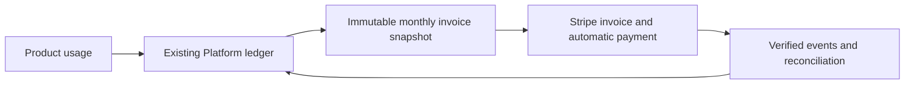

# Monthly postpaid Platform billing implementation plan

Status: proposed; implementation has not started.
Date: October 14, 2026.

## Outcome

Let a developer account add a payment method, incur usage within an approved credit
limit, and pay one consolidated invoice automatically after each calendar month.
Platform owns payment methods, credit policy, invoices, and collection. Products
continue to report durable usage through the existing account integration.

This feature builds on [Shared Account Platform](feat-1-shared-account-platform.md).
It is independent of the [Console split](feat-2-platform-console.md). It requires
no frontend moves, new Worker, new database, or new subscription engine.

## Terminology and scope

Use the [Platform glossary](platform-glossary.md). This is **developer billing**:
Seams charges its developer accounts for Wallet and Satyr usage. **Application
billing**, where a developer charges end customers, is outside this plan.
A Stripe Customer here represents the payer for a developer billing account.
Existing `orgId`, `organizationId`, and `billingAccountId` fields retain their names
and persisted meaning. This terminology update adds no application or end-customer
organisation records.
Project environments retain their development/staging/production meaning.

## First-release scope

- Use Stripe, USD, and UTC calendar months. Start with cards saved for future
  automatic payments through Stripe-hosted Checkout in setup mode.
- Keep one billing account and one persisted Stripe Customer mapping per
  developer account. Consolidate developer projects and enabled products into that account.
- Keep Platform's existing meters and price versions authoritative. Send fixed
  invoice amounts to Stripe. Do not duplicate usage metering in Stripe.
- Preserve existing prepaid accounts. Offer postpaid to explicitly approved
  accounts with no prepaid balance, unsettled reservations, or unresolved billing
  obligations. Existing funded-account conversion is separate work.
- Represent prepaid and postpaid as explicit account states within the existing
  billing service. They are supported payment models, with one active model per
  account. Do not add a legacy mode or parallel billing implementation.
- Require completed payment setup and a positive, explicitly approved credit limit
  before new paid work. A saved card alone grants no credit.
- Preserve existing product prices. Satyr fees charged to developer accounts remain unpriced until
  approved. Its isolated test price must remain unavailable to non-test developer accounts.
- Defer bank debits, multiple currencies, mid-month threshold charging, custom
  payment terms, automatic credit scoring, and arbitrary billing cycles.

Proposed defaults: close the previous month from 01:00 UTC on the first day of the
next month. Allow seven days from the first collection failure before blocking new
paid work, subject to the credit limit throughout. Confirm these defaults and the
initial credit limits before enabling non-test developer accounts. Record the applicable
tax treatment and billing details before production collection. A USD-only release
does not determine tax treatment. Use Stripe's existing tax facilities if required.

## Reuse and ownership

Paths below are relative to this repository. Keep their current owners.

| Existing code                                                                    | Extension                                                                          |
| -------------------------------------------------------------------------------- | ---------------------------------------------------------------------------------- |
| `packages/console-server-ts/src/billing/{service,d1,types,ledger}.ts`            | Account payment model, receivables, invoice snapshots, and payment reconciliation  |
| `packages/console-server-ts/src/billing/{usage,pricing,attribution}.ts`          | Reuse meters, immutable prices, source evidence, and project attribution           |
| `packages/console-server-ts/src/billing/{providers,stripeProvider}.ts`           | Stripe Customer mapping, payment setup, invoice creation, and provider lookup      |
| `packages/console-server-ts/src/billing/{stripeWebhook,stripePostProcessing}.ts` | Payment events and durable follow-up work                                          |
| `packages/console-server-ts/src/billingPrepaidReservations/`                     | Extend existing atomic admission and reservation transitions for postpaid credit   |
| `packages/console-server-ts/src/router/cloudflare/billingRoutes.ts`              | Payment setup and billing account operations with existing permissions             |
| `packages/console-shared-ts/src/accountPlatform/`                                | Narrow contract changes required by admission and billing state                    |
| Existing Console billing pages                                                   | Payment method, current costs, credit availability, invoices, and recovery actions |
| Existing scheduled Console work and product outboxes                             | Monthly close, provider reconciliation, and durable usage delivery                 |

Current Stripe support covers credit purchases and refunds. Current ledger
postings use `org_prepaid_liability`. Current billing documents include purchase
receipts and usage statements. These are useful foundations, but they do not
already implement postpaid collection.

Extend the existing ledger with receivable and payment postings. Record usage as
money owed, then reduce that receivable when payment succeeds. Invoice creation
must not recognise the same usage twice. A postpaid payment is not a credit-pack
purchase. Keep historical prepaid postings and documents unchanged.

## Payment methods

1. Reuse the developer account's existing billing permissions for payment administration.
   Resolve the billing account on the server. Never accept another account's
   Stripe Customer or payment method from browser input.
2. Persist or reconcile the account's Stripe Customer before starting setup. Enforce
   one mapping through existing D1 transaction and idempotency patterns.
3. Create a Stripe Checkout setup session for that Stripe Customer. Explain the monthly
   billing schedule and obtain authorisation for future automatic payments.
4. Verify successful setup through the signed webhook or a server-side Stripe
   lookup. A browser success redirect does not establish payment readiness.
5. Set the verified method as the Stripe Customer's invoice default. Persist only provider
   references and display fields such as brand, last four digits, and expiry.
   Stripe retains the payment credentials.
6. Support adding a replacement and selecting the default through the same flow.
   Allow removal of the last method only when paid services are disabled and no
   outstanding charges or commitments remain. External removal or expiry blocks
   new paid work until the account has a usable method.

Reuse existing redirect validation, CSRF protection, authentication, and audit
records. Payment repair and invoice access remain available when paid work is blocked.

## Credit limits and admission

The credit limit bounds the developer account's total unpaid exposure across all
projects, products, and billing months. It does not reset at month-end.

```text
available credit = approved credit limit
                 - unpaid posted charges
                 - active execution commitments
```

Unpaid charges include unbilled usage and invoiced debt, counted once. Commitments
include reserved and indeterminate work. Account for applicable tax exposure in
admission where required by the configured tax treatment.

- Permit only authorised Platform support to set the approved limit. Developer
  account administrators can view it and request changes. Persist changes with the existing audit machinery.
- Check account readiness and available credit in the existing atomic admission
  transaction. Concurrent requests must not each spend the same remaining credit.
- Reuse reservations for bounded execution commitments. On final usage, replace the
  commitment with the actual receivable atomically. Release confirmed unused amounts.
- Reserve a sufficient bound before provider work. An extension must pass another
  atomic admission before further spend. Unknown outcomes retain their commitments.
- Pin the account payment model and accepted pricing to the reservation. A retry or
  later account change must not reinterpret an accepted financial obligation.
- Cover every charge path, including monthly active resources. Admit the resource
  fee in its existing authoritative transaction before accepting the billable action.
  For recurring resources, establish the next period's charge before allowing new
  paid use. Preserve existing meter semantics and deduplication.
- Lowering a limit below existing exposure blocks further spend. It does not delete
  debt, release commitments, or cancel accepted settlement.
- Enforce payment restrictions on new paid work only. Preserve access to existing
  wallets and custody/recovery operations that do not incur a new service charge.

Keep Stripe calls and awaited billing delivery out of registration, unlock, signing,
and response paths. Use persisted account state inside existing admission operations.
Do not add serial account calls or request-time schema setup. Verify the affected
Wallet query budgets; do not weaken atomic credit enforcement to meet a budget.

## Monthly close and automatic collection



1. Extend existing scheduled billing work to close eligible accounts independently.
   A failed account or provider request must not prevent other accounts from closing.
2. Atomically assign eligible, unbilled charge records to one immutable invoice
   snapshot. Enforce one regular close per billing account and UTC month. Preserve
   project, service, meter, price version, and original usage timestamps.
3. Record durable delivery work with the snapshot. Aggregate Stripe line items by
   project, service, and price where practical; retain detailed usage in Platform.
4. Create a Stripe draft with automatic advancement disabled. Add the complete
   snapshot's line items, verify totals, and then finalise with automatic collection
   enabled and `collection_method=charge_automatically`.
5. Persist Stripe invoice and operation references. Use stable idempotency keys for
   each external mutation. After a lost response, reconcile the original operation
   before retrying. An expired provider idempotency window must not create a second
   invoice or payment; unresolved ambiguity requires reconciliation.
6. Reconcile verified invoice/payment events into the existing ledger and invoice
   store. Verify Stripe Customer, currency, amount, and snapshot association. Deduplicate
   events and prevent delayed failure events from reversing a confirmed payment.

Payment confirmation reduces unpaid exposure once. Invoice creation, finalisation,
or a browser return must not reduce it. Keep Stripe's invoice reference and hosted
document in the existing invoice UI. Add a collectible invoice document type;
do not turn previously paid usage statements into new payment requests.

Close against a fixed ingestion cutoff. Usage received after the cutoff enters the
next open invoice as a prior-period item, with its original usage month visible.
Never discard late usage or mutate a finalised invoice's usage snapshot. Correct
finalised invoices through recorded adjustments and the matching Stripe credit-note
or refund operation. Reuse existing refund and reconciliation patterns.

Skip collection for a zero amount due. Retain amounts below Stripe's applicable
minimum as uninvoiced carry-forward charges, with an explicit receipt of the close.
They remain part of unpaid exposure and must appear in the next eligible close.

## Failed payments and recovery

Keep invoice collection state separate from the account's permission to incur new
charges. A replacement card does not prove that old debt was paid.

| Condition                            | Collection behaviour                                     | New paid work                                                        |
| ------------------------------------ | -------------------------------------------------------- | -------------------------------------------------------------------- |
| Setup incomplete or no usable method | Offer payment setup                                      | Blocked                                                              |
| Invoice payment processing           | Await provider confirmation                              | Allowed within remaining credit if the account is otherwise eligible |
| First failed payment                 | Notify the billing owner; start the fixed grace deadline | Allowed during grace and within credit                               |
| Authentication required              | Link to Stripe's payment recovery page                   | Same grace and credit policy                                         |
| Grace expired or credit exhausted    | Continue recovery and reconciliation                     | Blocked                                                              |
| Confirmed payment                    | Apply the payment once; recompute account eligibility    | Resume only when all blocking conditions are cleared                 |

Configure Stripe's invoice retry policy and recovery emails. Do not implement a
second card-charge retry scheduler. Reuse the existing scheduled work to reconcile
missing events and retry failed API delivery. Repeated events, card replacement,
and later invoices must not extend the original delinquency deadline.

An uncollectible invoice or dispute must not silently restore spending authority.
Keep the account restricted until payment or an audited support resolution permits
further credit. Preserve debt and product records. Continue delivery and settlement
of previously accepted work after suspension, revocation, or product disablement.

## Implementation phases

### 1. Account state and payment setup

- Add the required persisted account state and Stripe Customer mapping through
  forward migrations. Preserve applied migration files and existing records.
- Model payment model, readiness, and collection lifecycle with branch-specific
  builders and discriminated unions. Parse provider and database records once at
  boundaries. Use required branch fields, `never` exclusions, and exhaustive switches.
- Extend the provider adapter, billing routes, webhook handling, and existing UI for
  setup and replacement. Reuse current permission and audit checks.

Exit: an authorised owner can establish a verified default payment method.
Foreign methods, failed setup, and forged success redirects cannot enable spending.

### 2. Postpaid admission and ledger

- Extend current account factories, reservation transactions, charge posting, and
  overview calculations. Keep one implementation for shared reservation transitions.
- Add receivable/payment postings and explicit credit-limit administration. Update
  every affected charge path and retain existing prepaid behaviour.
- Add type fixtures for invalid lifecycle combinations, broad spreads, and direct
  object construction. Preserve the existing boundaries against unsafe domain casts.

Exit: concurrent paid operations respect one developer account limit. Settlement and
release preserve balanced postings and never count a commitment and its charge twice.

### 3. Close, collect, and recover

- Extend the current monthly document flow with immutable snapshots and durable
  Stripe delivery. Reuse the existing scheduled worker and retry conventions.
- Implement automatic collection, late usage, zero/minimum amounts, payment
  reconciliation, grace expiry, and recovery through the existing billing service.
- Extend billing pages with payment details, accrued costs, outstanding invoices,
  available credit, the next close date, and clear recovery actions.

Exit: a repeated close or lost provider response produces one collectible invoice.
Payment failure restricts new spend without losing usage or preventing payment repair.

### 4. Acceptance and rollout

Read `tests/AGENTS.md` before changing tests. Extend the existing composed billing,
funds, and usage journeys under `tests/e2e/console/`. Add no unit tests or source-text
guards. Use real D1 behaviour and Stripe test mode for provider acceptance.

One composed journey must cover a developer account with multiple developer
projects and services:

1. Add and replace a card; reject foreign-account access and incomplete setup.
2. Race admissions near the credit limit; prove that only permitted work proceeds.
3. Commit usage, lose its delivery response, restart, and replay without double billing.
4. Close the month twice, including a lost Stripe response. Verify one invoice,
   correct attribution, balanced ledger postings, and unchanged prepaid documents.
5. Deliver late usage and verify next-period inclusion. Cover zero/minimum amounts.
6. Fail collection, require payer action, expire grace, and reject new paid work.
   Deliver accepted terminal usage while blocked. Replace the card and confirm payment.
7. Replay and reorder payment events. Verify debt clears once and access resumes
   only when all account restrictions permit it.

Use controlled application time for the calendar and grace transitions. Use Stripe
test payment methods and provider events for collection; test the selected one-off
invoice integration rather than assuming subscription test-clock behaviour.

Save repeatable evidence under `.artifacts/platform-billing/`: exact commands,
source revisions, redacted provider references, invoice documents, ledger exports,
reservation reconciliation, screenshots, and traces. Run narrow E2Es during each
phase, then `pnpm check` for the shared billing change. Run `pnpm test:scripts` if
deployment scripts or workflows change. Check affected Wallet call budgets.

Deploy migrations and code to staging first. Enable isolated postpaid test accounts
through the account policy. Confirm developer pricing, limits, grace, tax handling,
and payment authorisation before a bounded production rollout. Keep existing funded
accounts prepaid. Enabling postpaid must not deploy Wallet or change Satyr pricing.

For rollback, stop new postpaid admissions while retaining usage delivery, collection,
and payment reconciliation. Do not deploy code that cannot read accepted postpaid
records. Do not reverse financial history or switch accepted obligations to prepaid.
Report local validation, staging, and production separately.

## Completion criteria

- Payment methods and automatic-payment authorisation belong to the billing account.
- Credit admission is atomic across products and includes unsettled commitments.
- Each period produces an auditable close, with one invoice when the amount is collectible.
- Failures preserve debt, enforce the grace policy, and provide a recovery path.
- Existing prepaid behaviour, product prices, and protected Wallet paths remain intact.
- Shared billing code owns the feature; products retain measurement and execution.

## Stripe references

- [Save payment details through Checkout](https://docs.stripe.com/payments/save-and-reuse?platform=web&ui=stripe-hosted)
- [Create invoices and select automatic collection](https://docs.stripe.com/api/invoices/create)
- [Automatic collection and recovery notifications](https://docs.stripe.com/invoicing/automatic-collection)
- [Payment retries and failures that require payer action](https://docs.stripe.com/billing/revenue-recovery/smart-retries)

Verify the implementation against the configured Stripe API version before coding.
