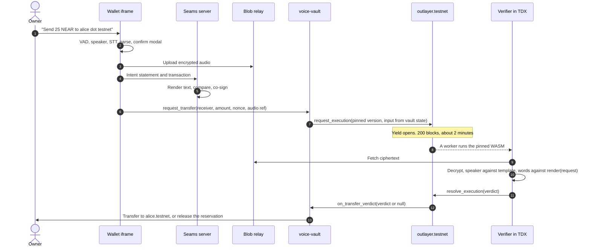
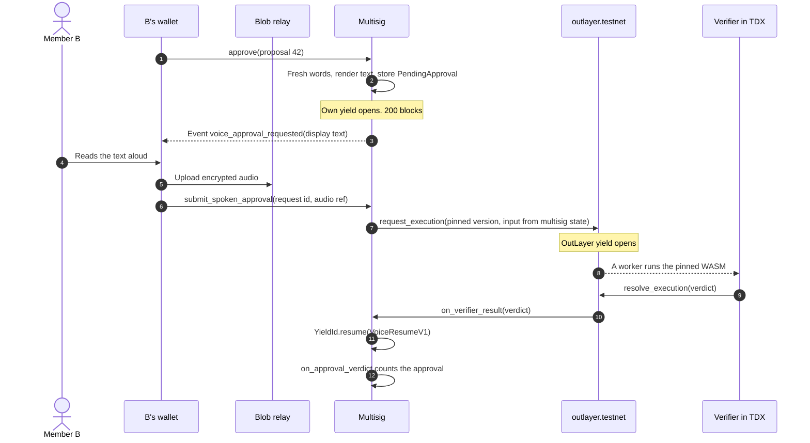

# Refactor 210 — voice intents with OutLayer and yield/resume

Status: plan only, written 2026-11-06. It changes no production code. All work
runs on NEAR testnet.

**Update 2026-11-09: the shared vault design is retired.** The Wallet now pays
from the owner's own account after Wallet core checks the verifier's verdict.
There is no vault contract (`seams-wallet.testnet` is no longer used), no
`transfer_with_verdict`, no contacts with a delay and no on-chain limits.
Section 0 says what runs now. `seams-wallet/docs/refactor-227-speak-to-sign-without-passkey.md`
owns that design. Sections 1 to 9 describe the vault and the
yield/resume design. They stay as the record of the first design, with the
measured results. Where they differ from Section 0, Section 0 is right.

This plan covers two VoiceID concepts for the NEAR team:

1. **Speak-to-Sign vault** (retired on 2026-11-09; now Speak-to-Sign from the
   owner's account): the main concept.
2. **Spoken multisig**: a follow-up.

VoiceID source lives in `seams-wallet`. This plan builds on
`docs/voiceid-current-state.md`,
`packages/shared-ts/src/authorization/voiceIdDeviceAssertion.ts` and
`packages/wallet-server/src/authorization/voiceIdDeviceProof.ts` in that
repository.

These concepts check the voice for each transfer. For this hackathon, the
user set aside the 2026-11-04 decision (a VoiceID unlock opens a session with
no voice check for each transaction). That decision still applies to releases.

## 0. Current design (2026-11-09)

Gate 0 and the 10 s latency rule changed the design on 2026-11-07. On
2026-11-09 option G replaced the vault. This section replaces the on-chain
flow in Sections 1, 3, 4 (the vault), 4.5–4.6 and 7.2–7.4 where they differ.
Those sections stay as the record of the first design.

- **Path.** The Wallet calls the verifier through the Seams verify route
  (`POST /speak-to-sign/v1/verify`), which calls OutLayer's HTTPS API
  (`POST /call/seams-v1.testnet/voice-verifier`, payment key, `version_key`,
  `secrets_ref`). The audio travels inside the request. There is no
  `request_execution`, no yield and no blob relay. The on-chain path took
  25–35 s (Section 11.5).
- **Verifier.** An OutLayer worker without `tract`, 335 KB in version 0.3.1. It calls the
  Phala speaker service (ReDimNet in a dstack CVM, signed embeddings, pinned
  key) and NEAR AI Whisper large-v3 at the same time. It compares the
  embedding with the template in OutLayer storage (cutoff 0.45), checks the
  words with `spoken_intent::normalize_punctuated` against `render` of the
  request, runs a policy step, and marks the audio digest used. The operations
  are `enroll` and `verify`.
- **Verdict v2.** The verdict is signed with the project-bound ed25519 key
  `ed25519:E8E53ydtc9LRvVz9xBCRrSzyBa5nh1gK1ts53Aoo751U`. It has 13 fields,
  `outcome` `accept`, `step_up` or `refuse`, and `expires_at_ms` (the worker
  clock plus 120 s). The Wallet pins the key in its code, one key for each
  network.
- **The Wallet signs (option G).** Wallet core checks the verdict: the pinned
  key, the signature, the request and spoken-text digests, the digest of a clip
  that core recorded in this flow, and the expiry. On `accept`, the Wallet
  builds the transaction from the request and signs it from the owner's own
  account through the Wallet Session. There is no confirm and no passkey. The
  owner pays the gas, and core signs once for each verdict. On `step_up`, core
  asks for a fresh approval with the session's own method. A cold session needs
  an unlock first.
- **Step-up.** The policy step can only tighten a decision. One stub rule
  stands in for the policy engine of Refactor 225: a payment above 10 NEAR
  needs a passkey.
- **Enrollment.** The owner signs one NEP-413 message with a full-access key
  of the owner account. The verifier checks the signature and reads the key
  over NEAR RPC. The template key is `template:v3:<owner>`.
- **No vault.** There is no vault contract, no deposit, no contact list with a
  delay and no on-chain limit. The `contacts` input is optional and only helps
  the confusion set. A transfer can go to any named account.
- **What changed in trust.** The checks that the vault made on chain (the
  signature, the nonce, the contact, the limits and audio reuse) moved. Wallet
  core checks the signature, the digests and the expiry. The verifier marks
  each recording used. Core signs once for each verdict. A check of the verdict
  by the Seams co-signer and voice limits for each wallet are planned and not
  built (Refactor 227, Step 1b). The user accepted a trusted, off-chain design
  on 2026-11-09.
- **Versions.** Version 0.3.1 of the verifier runs on OutLayer testnet (version
  key `5b6fad5df11440847e13508f57736da8de371526824cf12178dfc20be2c9c1d1`).
  Version 0.4.0 adds spoken community notes and note ratings. It is on OutLayer
  as version `8a0b7ba0dff61a4b45e5d1d164c011525e11fe9f4fd02a4e22368882447329ef`
  and is not active.
- **What OutLayer still adds.** The TEE run of pinned code, its storage of
  the template and used audio, its signing key, and the secret for NEAR AI.
  This meets the hackathon rule. Yield/resume is no longer used; the spoken
  multisig (Section 5) would need it again.
- **New trusted parties.** NEAR AI's gateway for the transcript
  (transcriptions carry no signature), Phala's dstack KMS and gateway for
  the speaker embedding, and the project owner, who can deploy a version
  that signs with the project-bound key. The Phala app owner can also change
  the speaker service code without changing its pinned key, because dstack
  derives the key per app, not per compose hash. The NEAR RPC node is also
  trusted for the access-key view at enrollment.
- **Measured** (testnet, [evidence](evidence/refactor-210-gate0/README.md)):
  end of speech to receipt 9.2 s; verification 5.7 s; vault transaction
  3.5 s. All six refusal cases held. These runs used the vault, which is
  retired (Section 0.1). One live Wallet run of option G (2026-11-09, 1 run)
  took 9.2 s from the end of speech to the receipt.
- **Later.** This chain is the hackathon path. Section 14 plans a follow-up
  phase: the chain becomes optional, and Seams provides a version that it
  hosts fully on Cloudflare.

### 0.1 The vault design of 2026-11-07 (retired)

Until 2026-11-09 the design had a shared vault contract. The bullets below
record it. Do not build on it.

- **Vault.** One transaction, `transfer_with_verdict`. The vault rebuilt the
  request digest from its state and the arguments, checked the signature
  against the verifier key that it pinned at init, the nonce, the contact,
  the limits and audio reuse, and paid. The testnet vault was
  `seams-wallet.testnet`. It also had `authorize_enrollment`, contacts with a
  delay, limits and a 10-minute withdrawal without voice.
- **Verifier of that time.** Version `b4d68fb6…fdd0`. Verdict v2 replaced its
  verdict format. Its `enroll` needed the owner's `authorize_enrollment` call
  on the vault, and its template key held the vault name.
- **What is left.** The deployed contract keeps its withdrawal methods, so a
  testnet owner can still withdraw. The source is only in the git history of
  `seams-voice-intents` (removed in commit `3dab63d`). The measured results of
  the vault path stay in Sections 11.1 and 11.5.

## 1. Result

- Both concepts put the decision in a NEAR contract. The contract sends the
  request from its own state to a pinned OutLayer verifier through
  `request_execution`. The verifier hears the raw audio. It checks the speaker
  against a template that it seals in OutLayer storage. It compares the words
  with its own text of the request. The result returns through the
  yield/resume inside `outlayer.near`. The contract acts only on that result.
- Speak-to-Sign needs one transaction. The audio exists before the
  transaction, so the vault needs no yield of its own. The yield inside
  `outlayer.near` does the work.
- The spoken multisig adds its own yield. `approve` issues two fresh words and
  waits up to 200 blocks (about 2 minutes) for the spoken answer. The protocol
  sets this time bound. No server clock sets it.
- What this adds: Seams serves the Wallet origin and runs the co-signer. Today,
  an attacker who controls the code at `walletOrigin` can sign any operation
  in a session that the user opens. With the vault, funds move only after code
  that the vault pins hears the owner say the text of the request.
- What this does not add: protection against a good voice clone that a
  compromised device plays, and protection if OutLayer's TEE or its governance
  fails. Section 8 gives the threat model.

## 2. Facts checked on 2026-11-06

### NEAR

| Fact                                                                                                                                                                                                                                                                                                                                                  | Source                                                                                   |
| ----------------------------------------------------------------------------------------------------------------------------------------------------------------------------------------------------------------------------------------------------------------------------------------------------------------------------------------------------- | ---------------------------------------------------------------------------------------- |
| `yield_timeout_length_in_blocks` is 200 and `max_yield_payload_size` is 1024 bytes on mainnet and testnet, protocol 88.                                                                                                                                                                                                                               | `EXPERIMENTAL_protocol_config` on `rpc.mainnet.near.org` and `rpc.testnet.near.org`      |
| Mean block time over the last 1,000 heights: 0.58 s on mainnet and 0.60 s on testnet. 200 blocks is about 2 minutes. At 1.2 s blocks it is about 4 minutes.                                                                                                                                                                                           | `block` RPC, two heights 1,000 apart                                                     |
| `max_transaction_size` is 1,572,864 bytes. `max_arguments_length` is 4,194,304 bytes. `max_total_prepaid_gas` is 1,000 Tgas.                                                                                                                                                                                                                          | `EXPERIMENTAL_protocol_config`                                                           |
| near-sdk 5.29: `Promise::new_yield(...)` returns a promise and a `YieldId`. `YieldId::resume(...)` resumes it. After 200 blocks the callback gets `Err(PromiseError::Failed)`. A callback that panics reverts its own state cleanup, so a callback must return a value. Anyone can call a public resume method unless the contract checks the caller. | [docs.near.org yield/resume](https://docs.near.org/smart-contracts/anatomy/yield-resume) |

### OutLayer

| Fact                                                                                                                                                                                                                                                                                                                                                                                              | Source                                                                                                                                                   |
| ------------------------------------------------------------------------------------------------------------------------------------------------------------------------------------------------------------------------------------------------------------------------------------------------------------------------------------------------------------------------------------------------- | -------------------------------------------------------------------------------------------------------------------------------------------------------- |
| A contract calls `request_execution` on `outlayer.testnet` or `outlayer.near`. Arguments: `source`, `input_data`, `resource_limits`, `response_format`, `secrets_ref`, `payer_account_id`, `params`. The WASM runs in an Intel TDX enclave.                                                                                                                                                       | [NEAR integration](https://app.outlayer.ai/docs/near-integration), [docs.near.org OutLayer](https://docs.near.org/primitives/off-chain-compute/outlayer) |
| `source` is `Project { project_id, version_key }` or `WasmUrl { url, hash, build_target }`. `version_key` is the WASM hash of a version. Null runs the active version. The worker refuses bytes that do not match the hash.                                                                                                                                                                       | NEAR integration                                                                                                                                         |
| `request_execution` creates a yield. A registered worker key resumes it with `resolve_execution` (at most 1024 bytes) or `submit_execution_output_and_resolve` (larger output). The caller's callback gets the output as a JSON value, or null when the run failed. A run that outlives 200 blocks pays only the base fee. The sender can call `cancel_stale_execution` after 10 minutes.         | [contract README](https://github.com/fastnear/near-outlayer/blob/main/contract/README.md)                                                                |
| Input of 10,000 bytes or more is left out of the `execution_requested` event, and the worker reads it from state. Above 32 KB, each extra byte costs 0.00001 NEAR of held deposit and 25 MGas.                                                                                                                                                                                                    | contract README                                                                                                                                          |
| The limits differ between pages. HTTPS API: `max_instructions` default 1 billion, maximum 500 billion; `max_memory_mb` default 128, maximum 512; `max_execution_seconds` default 60, maximum 180. The contract README: `get_max_limits` returns `[500000000000, 180, 300]` and memory is capped at 4096 MB. The WASI page: up to 100 billion instructions and 60 s. Gate 0 reads the live values. | [HTTPS API](https://app.outlayer.ai/docs/https-api), contract README, [WASI](https://app.outlayer.ai/docs/wasi)                                          |
| Storage, NEAR RPC, signing keys and encryption keys need `wasm32-wasip2`. Outbound HTTP is P2 only, through `wasi-http-client`. Output is JSON on stdout. The WASI page says at most 900 bytes; Gate 0 received 3,061 bytes through the two-call path. A P2 run has no files.                                                                                                                     | WASI, [docs.rs/outlayer](https://docs.rs/outlayer/latest/outlayer/) 0.2.1                                                                                |
| Storage is per project and per account. The manifest field `storage_account` is `signer` (default) or `predecessor`. Over HTTPS the account is the payment-key owner. All versions of a project share storage. `get-by-version` reads data that one WASM hash wrote. `set-if-absent`, `set-if-equals` and `increment` are atomic. The keystore encrypts records.                                  | [Storage](https://app.outlayer.ai/docs/storage)                                                                                                          |
| Signing keys: `ed25519` or `secp256k1`, at most 3. `bind: "project"` keeps the key across code upgrades. `bind: "wasm"` ties the key to one WASM hash and the caller.                                                                                                                                                                                                                             | [Signing keys](https://app.outlayer.ai/docs/signing-keys)                                                                                                |
| Encryption keys are symmetric only (XChaCha20-Poly1305). There is no public key for outside clients. The verifier must make its own key pair to receive audio.                                                                                                                                                                                                                                    | [Encryption keys](https://app.outlayer.ai/docs/encryption-keys)                                                                                          |
| An Intel TDX quote covers a task hash over fields that include `wasm_hash`, `input_hash`, `output_hash` and `block_height`. The chain checks quotes only when a worker registers. A result is trusted through the registered worker key.                                                                                                                                                          | [TEE attestation](https://app.outlayer.ai/docs/tee-attestation)                                                                                          |
| OutLayer says that its operator can refuse or stop work. It says that the operator cannot change results without a registered key or run unapproved worker builds. The README says that governance uses single keys: a DAO full-access key, owner-only measurement approval and key-based contract upgrades. No page documents a GPU.                                                             | [Trust and verification](https://app.outlayer.ai/docs/trust-verification), [repository README](https://github.com/fastnear/near-outlayer)                |
| HTTPS API: `POST /call/{owner}/{project}` with an `X-Payment-Key` header. `version_key` pins a version. Each call has an `attestation_url`.                                                                                                                                                                                                                                                       | HTTPS API                                                                                                                                                |

## 3. What OutLayer and yield/resume add

### 3.1 Plain Speak-to-Sign needs neither

The user's Speak-to-Sign flow works inside the Wallet iframe alone:

1. An app button opens the Seams modal with voice capture and a suggested
   sentence.
2. The user says "Send 25 NEAR to alice dot near". Words light up as the user
   speaks.
3. The device runs VAD, the speaker check and speech-to-text, then parses the
   words into an intent.
4. The Wallet builds the transaction. The confirm modal shows it with the words
   that the Wallet heard.
5. Dispatch happens by auto-dispatch, by "continue" or by a click.
6. The device key signs the digest, the challenge and the intent text.
7. The Seams server turns the transaction back into text and compares the two
   texts.

The server check in step 7 is useful, but both texts come from code that Seams
serves at `walletOrigin`. The check shows that this code agrees with itself. It
does not show that anybody heard a voice.

### 3.2 Comparison

| Question                                          | Wallet iframe and Seams server                                                    | Vault or multisig with the OutLayer verifier                                            |
| ------------------------------------------------- | --------------------------------------------------------------------------------- | --------------------------------------------------------------------------------------- |
| Who hears the audio?                              | `walletOrigin` code only                                                          | `walletOrigin` code, then the pinned verifier                                           |
| Who makes the text that the words must match?     | `walletOrigin` code; the server compares it with a second text from the same code | The contract sends its own state; the verifier renders it                               |
| Who can change the request after the user speaks? | Compromised `walletOrigin` code                                                   | Nobody. A changed request gives a different text, and the words do not match            |
| What can control of `walletOrigin` do?            | Sign any operation in an open session                                             | It must also produce the owner's voice saying the exact text; contacts and limits apply |
| What can a compromised Seams server do?           | With `walletOrigin`: everything in a session                                      | Refuse service; read ciphertext only                                                    |
| Where is the voice template?                      | The enrolled browser                                                              | Sealed in OutLayer storage, in the contract's namespace                                 |
| Who delivers the decision to the chain?           | The Seams co-signer                                                               | `outlayer.near` resumes its yield; no Seams key is in the path                          |
| What bounds freshness?                            | A 60 s device statement window, set by the Seams server clock                     | Multisig: 200 blocks after the fresh words, set by the protocol                         |

### 3.3 Why the Seams server cannot do this

- The Seams server could run the same models. The contract would then trust a
  Seams key, and Seams would keep a voice database. That design moves the
  models. It does not add an independent check.
- The audio cannot go through a NEAR transaction. Eight seconds of 16 kHz mono
  PCM16 is 256,000 bytes. At 25 MGas for each byte above 32 KB, the input alone
  needs more than 5,000 Tgas. A transaction gets at most 1,000 Tgas. So the audio
  goes through an HTTPS blob relay that sees only ciphertext.

## 4. Concept 1: Speak-to-Sign vault

Retired on 2026-11-09. This section is the record of the vault design. Section
0 says what runs now.

### 4.1 Scope

- In scope: native NEAR transfers from a vault to any named account that the
  text can say (it need not be a contact), one pending request for each
  owner, testnet.
- Out of scope: fungible tokens, swaps, function calls, other chains, mainnet.

### 4.2 Components

1. **Wallet iframe** (`walletOrigin`, `seams-wallet`): capture, live word
   highlight, local VAD, ReDimNet and speech-to-text, intent parse, confirm
   modal, device statement, audio encryption and upload.
2. **Seams server** (`wallet-server`): co-signs the NEAR transaction through
   threshold signing after its policy and text check. It also serves the blob
   relay.
3. **Blob relay**: an HTTPS endpoint that keeps one ciphertext for at most 5
   minutes. The vault pins its host name.
4. **`voice-vault` contract** (Rust, near-sdk): balances, contacts, limits,
   nonces, the pinned verifier version and the verifier audio key. It requests
   verifier runs and moves funds in the callback.
5. **`seams-voice-verifier`** (Rust, `wasm32-wasip2`, OutLayer project
   `seams.testnet/voice-verifier`): operations `audio_key`, `enroll` and
   `verify`. Its manifest sets `storage_account: "predecessor"`, so each
   calling contract has its own storage namespace. The manifest also sets
   `callers.contract.only` to the vault contracts, which refuses direct and
   HTTPS runs, and `network` to the relay host alone (Gate 0, item 6).
6. **`outlayer.testnet`**: queue, workers, yield/resume and refunds.

### 4.3 Who trusts what

| Component    | Trusts                                     | For                                                           | If that party lies                                                                                             |
| ------------ | ------------------------------------------ | ------------------------------------------------------------- | -------------------------------------------------------------------------------------------------------------- |
| Vault        | `outlayer.near` and its registered workers | The pinned WASM ran on the vault's input                      | False verdicts. This is the root trust.                                                                        |
| Vault        | Verifier code at the pinned hash           | Speaker and word decisions                                    | Wrong decisions. Audit the code and measure the models.                                                        |
| Vault        | Nothing off chain                          | —                                                             | —                                                                                                              |
| Verifier     | Its input                                  | The request fields                                            | The input comes from the calling contract. Another caller gets its own empty namespace, with no templates.     |
| Verifier     | Blob relay                                 | Availability only                                             | The digest check fails, and the verifier refuses.                                                              |
| Verifier     | Sealed template                            | The owner's voice                                             | Section 4.4 limits who can enroll.                                                                             |
| Wallet       | NEAR RPC node                              | Contacts, limits and the audio key for display and encryption | A wrong display gives a word mismatch, and the vault refuses. A false audio key leaks the audio (Section 8.3). |
| Seams server | Device intent statement                    | Its co-sign policy                                            | No effect on vault safety                                                                                      |
| Owner        | Confirm modal                              | What the Wallet shows                                         | The verifier catches a changed amount or recipient.                                                            |

### 4.4 Setup and enrollment

1. The deployer initializes the vault contract. The vault requests the
   verifier operation `audio_key`. The verifier makes an X25519 key pair with
   `set-if-absent`, keeps the private key in storage, and returns the public
   key. The callback stores it. Clients read it with
   `get_verifier_audio_key()`.
2. The owner calls `create_vault()` with a deposit. The owner can be any NEAR
   account, including an implicit account, because the spoken text does not
   say it. The vault records the owner, an empty contact list and default
   limits.
3. The owner calls `add_contact(account_id)`. The vault renders the spoken
   name with the shared `spoken-intent` crate. It refuses an account that is
   not speakable. It refuses a contact whose `phonetic_key` equals, or is one
   edit from, the key of another contact. The contact becomes active after a
   delay (2 minutes on testnet for the demo).
4. The owner reads three fixed phrases. The Wallet encrypts each recording and
   uploads it. The owner calls `enroll_voice(audio_refs)`. The vault requests
   the operation `enroll`. The verifier computes three ReDimNet embeddings,
   checks that they agree, and stores the template at `template:<owner>` with
   `set-if-absent`. The callback records the template epoch.
5. In the MVP the vault refuses a second enrollment. To start again, the owner
   withdraws and makes a new vault.

Contacts are optional (changed on 2026-11-09). A voice transfer can go to any
named account that the text can say. The verifier checks the words against the
saved contacts, so a contact helps it refuse a sound-alike name. The vault
never adds a contact automatically.

The verifier namespace is the calling contract, so the HTTPS API cannot reach
the templates. Every `enroll` and `verify` run must come from the vault.

### 4.5 Transfer sequence



1. The app opens the Seams modal with a suggested sentence. The Wallet uses
   that sentence only for display and for the live highlight. It never builds
   a transaction from it.
2. The user says "Send 25 NEAR to alice dot testnet". About every 0.3 s, the
   Wallet aligns the CTC output with the suggested sentence and highlights the
   words.
3. The Wallet runs VAD, the speaker check and speech-to-text. `spoken-intent`
   parses the transcript into an intent. The recipient must be a named account
   that the text can say and that exists on the network, read through RPC.
4. The Wallet builds a `request_transfer` call with `receiver_id`,
   `amount_yocto`, `nonce` and `audio { url, digest }`. The confirm modal shows
   the transaction and the heard words.
5. Dispatch: auto-dispatch (amount below the auto limit, 3 s
   countdown), "continue" or a click. The Wallet encrypts and uploads the audio
   during the countdown.
6. The device key signs `voiceid_intent_statement_v1` (Section 7.1). The Seams
   server renders the text from the transaction arguments, compares it with the
   heard text in the statement, and co-signs.
7. The vault checks the transaction. The caller must be the owner. The receiver
   must be a named account that the text can say, and not the owner or the
   vault. The amount must be within the transfer limit and
   the daily limit. The nonce must be new, and no other request may be pending.
   The vault reserves the amount, stores `PendingTransfer` and computes
   `request_digest`.
8. The vault calls `request_execution` with
   `source: Project { project_id: "seams.testnet/voice-verifier", version_key: <pinned hash> }`,
   the input in Section 7.2, `payer_account_id: <owner>` and the callback
   `on_transfer_verdict(request_id)`. The 200-block window starts here.
9. A worker runs the verifier:
   1. Fetch the ciphertext from the pinned relay host and check its digest.
   2. Open it with HPKE.
   3. Refuse an audio digest that was used before (`set-if-absent audio:<digest>`).
   4. Check speech activity and audio quality.
   5. Compare a ReDimNet embedding with `template:<owner>`.
   6. Compare the words with `render(request)` (Section 9.3).
   7. Write the verdict (Section 7.3).
10. The worker resolves the request. `outlayer.testnet` resumes its yield.
    `on_transfer_verdict` gets the verdict, or null.
11. The callback checks `request_digest`, `request_id` and the outcome. If the
    outcome is `accept`, it calls `Promise::new(receiver).transfer(amount)`. For
    every other result it releases the reservation. It always deletes
    `PendingTransfer` and never panics.
12. The Wallet reads the transaction outcome. It shows the receipt or the
    reason for the refusal.

| Stage                    | Expected                     | Measured in Gate 0 |
| ------------------------ | ---------------------------- | ------------------ |
| Transaction to the vault | 2 blocks, about 1.2 s        | Yes                |
| Worker pickup            | Unknown                      | Yes                |
| Verifier run             | Unknown; target at most 10 s | Yes                |
| Resolve and callbacks    | 3–4 blocks, about 2.4 s      | Yes                |
| Window                   | 200 blocks, about 2 minutes  | —                  |
| Dispatch to receipt      | Target at most 15 s          | Yes                |

Failure handling:

- If no worker resolves within 200 blocks, the callback gets null and releases
  the reservation. The owner pays the base fee.
- If the relay loses the blob, the verifier refuses with `audio_unavailable`.
- If the local check passes but the verifier refuses, the Wallet says that
  nothing was sent and shows the reason.

### 4.6 Why the vault has no yield of its own

The audio exists before the transaction, so one transaction carries every
input. A second yield in the vault would wait for nothing. The yield inside
`outlayer.testnet` does the work: it brings the TEE result back to the
contract that asked for it.

### 4.7 Option: fresh words above the auto limit (not in the MVP)

For an amount above the auto-dispatch limit, the vault can yield its own
request. It issues two fresh words from `env::random_seed()`. The owner says
"Confirm two thousand five hundred near to alice dot testnet, river lantern"
within 200 blocks. This uses the same mechanism as Section 5.3. It conflicts
with the "no pass code" rule, so it is open question 4.

### 4.8 Vault rules for the owner key

- `add_contact`, `set_limits` and `set_verifier_version` take effect after a
  delay. The owner can cancel during the delay.
- `withdraw` to the owner's own account needs no voice, but it waits for a
  delay (10 minutes on testnet).
- So a stolen key alone cannot empty the vault before the owner notices. A
  voice alone cannot sign a transaction.

## 5. Concept 2: spoken multisig (follow-up)

### 5.1 Scope

A minimal multisig contract with typed proposals: `Transfer`, `AddMember`,
`RemoveMember`, `SetThreshold` and `SetVerifierVersion`. It has no free
`FunctionCall` proposal, because a free call has no exact text that a person
can say. Sputnik DAO v2 support is open question 7.

### 5.2 Components and trust

The multisig uses the same verifier and relay as the vault. Templates live at
`template:<member>` in the multisig namespace. Each member enrolls once at
setup. A new enrollment needs a proposal.

The Seams server is not in the trust path. Members do not need a Seams
wallet: any NEAR wallet can call the methods. The trust table in Section 4.3
applies, with the multisig in place of the vault and without the Seams server
row.

The contract sends the proposal from its own state to the verifier. This is
stronger than an RPC read: no RPC node and no signer computer is between the
chain and the verifier.

### 5.3 Approval sequence



1. A member creates a proposal. The contract stores it. It cannot change.
2. Member B calls `approve(proposal_id)`. The contract checks that B is a
   member, that the proposal is open, and that B has no approval or pending
   request for it. It takes two words from `env::random_seed()` and a list of
   64 words. It renders the expected text from the proposal and the words. It
   stores a `PendingApproval` record with `request_id`, `proposal_id`,
   `member`, `expected_digest`, `yield_id` and `start_height`. It emits the
   event `voice_approval_requested` with `request_id` and `display_text`. Then
   it yields with the callback `on_approval_verdict(request_id)`. The 200-block
   window starts here.
3. B's screen shows the text from the event, for example: "Approve proposal 42:
   send 10 NEAR to payroll.testnet. Then say: river lantern."
4. B reads the text aloud. The wallet encrypts and uploads the audio.
5. B calls `submit_spoken_approval(request_id, audio)`. The contract checks that
   B made the request and that at least 60 blocks of the window remain. It calls
   `request_execution` with the input from its own state and the callback
   `on_verifier_result(request_id)`.
6. A worker runs the same checks as in step 9 of Section 4.5, against
   `template:<B>`.
7. `on_verifier_result` builds `VoiceResumeV1` (Section 7.4) and calls
   `yield_id.resume(payload)`. If the yield has already ended, it logs the
   result and stops.
8. `on_approval_verdict` runs with the payload, or with `PromiseError` after 200
   blocks. If the outcome is `accept`, it counts B's approval. When the
   threshold is met, it executes the proposal. It always deletes the pending
   record.

Time budget: B has about 60 s from step 2 to step 5. The verifier run must end
before the window ends, so the contract sets `max_execution_seconds` to at most 30.

### 5.4 Where the yields do work

- The yield inside `outlayer.testnet` brings the verdict back to the contract,
  as in concept 1.
- The `approve` yield issues fresh words and accepts an answer only within 200
  blocks. A recording made before the words existed cannot match. The protocol
  sets this bound.
- The `approve` yield also gives one final result for the call and a sure
  cleanup. These two are conveniences: a map with expiry heights could do the
  same.
- The fresh words do not stop a real-time voice clone, which can say new words
  in seconds. They stop replay and splice attacks with real recordings, and
  they limit an attacker to about 2 minutes.
- If the user does not want fresh words, the proposal id already makes each
  text unique. The outer yield then adds only convenience. In that case, use one
  transaction: speak, then call `approve(proposal_id, audio)`.

### 5.5 The Bybit-style attack

In February 2025, injected code in the Safe web app showed signers a normal
transaction while they signed a malicious one. The attackers took about
$1.5B.

| What the injected code does                                                           | Result                                                                                                                   |
| ------------------------------------------------------------------------------------- | ------------------------------------------------------------------------------------------------------------------------ |
| It shows "send 10 NEAR to payroll", but the proposal moves all funds to the attacker. | B reads the false text. The verifier renders the real proposal. The words do not match, and the approval does not count. |
| It makes B sign `approve(43)` while it shows proposal 42.                             | The contract expects the text of proposal 43. The words do not match.                                                    |
| It shows the true text, and B reads it without attention.                             | The approval counts. Reading aloud makes this less likely, but it does not prevent it.                                   |
| It plays a real-time clone of B's voice and controls B's signing.                     | The approval can count. The speaker check is the only barrier, and it is weak against a good clone.                      |

## 6. Shared text function: `spoken-intent`

### 6.1 One source, four builds

`spoken-intent` is a Rust crate with `#![no_std]` and `alloc`. It uses no floats,
no locale, no clock and no randomness. The caller passes the challenge words
in. Its proposed home is `seams-wallet/crates/spoken-intent` (open question 1).

| Consumer           | Target                                                           | Use                              |
| ------------------ | ---------------------------------------------------------------- | -------------------------------- |
| Wallet iframe      | `wasm32-unknown-unknown` with wasm-bindgen, beside `near_signer` | Parse, render, display           |
| Seams server       | The same wasm module, loaded in the Worker                       | Render for the co-sign check     |
| Verifier           | `wasm32-wasip2`, linked                                          | Render, normalize, confusion set |
| Vault and multisig | `wasm32-unknown-unknown` through near-sdk, linked                | Render, digest, phonetic key     |

### 6.2 API sketch

```rust
pub enum SpokenRequestV1 {
    VaultTransfer {
        network: Network,
        vault: NearAccount,
        owner: NearAccount,
        receiver: SpokenAccount,
        amount_yocto: u128,
        nonce: u64,
    },
    MultisigApproval {
        network: Network,
        multisig: NearAccount,
        proposal_id: u64,
        proposal: ProposalV1, // typed kinds only; no free FunctionCall
        challenge: [ChallengeWord; 2],
    },
}

pub struct RenderedIntentV1 {
    pub display_text: String,
    pub spoken: Vec<SpokenToken>,
    pub spoken_text: String,
}

pub enum RenderResult {
    Rendered(RenderedIntentV1),
    Unsupported(UnsupportedReason),
}

pub fn render(request: &SpokenRequestV1) -> RenderResult;
/// sha256("seams:spoken-intent:request:v1" || borsh(request))
pub fn request_digest(request: &SpokenRequestV1) -> [u8; 32];
/// sha256("seams:spoken-intent:spoken:v1" || spoken_text)
pub fn spoken_text_digest(rendered: &RenderedIntentV1) -> [u8; 32];
pub fn normalize(transcript: &str) -> Option<Vec<SpokenToken>>;
pub fn parse_transfer(tokens: &[SpokenToken], contacts: &[SpokenAccount]) -> ParseResult;
pub fn confusion_set(request: &SpokenRequestV1, contacts: &[SpokenAccount]) -> Vec<Vec<SpokenToken>>;
pub fn phonetic_key(account: &SpokenAccount) -> PhoneticKey;
```

`SpokenAccount` can hold only an account that the grammar can speak. The parse
step is the inverse of the render step on the grammar:
`render(parse(tokens)).spoken == tokens` for each accepted token list.

### 6.3 Grammar rules

- **Amounts are exact.** A NEAR amount must be a whole multiple of 0.01 NEAR
  (10^22 yoctoNEAR) and at most 1,000,000 NEAR. Any other amount gives
  `Unsupported(AmountNotSpeakable)`. The crate never rounds.
- **Number words**: "twenty five", "two point five", "zero point two five",
  "one thousand two hundred fifty". After "point", each digit is one word.
  `normalize` maps "and" inside a number, "a hundred" and numerals in the
  speech-to-text output ("25") to the same tokens.
- **Accounts**: the text says only the receiver or the member, which must be
  a named account with lowercase letters and digits. The separators `.`, `-`
  and `_` become "dot", "dash" and "underscore". Each digit is one word. An
  implicit 64-character hex receiver or a `0x` receiver gives
  `Unsupported(AccountNotSpeakable)`. The vault, the owner and the multisig
  are not said. Each is a `NearAccount`, which can be any NEAR account,
  including an implicit one.
- **Sound-alike accounts**: `phonetic_key` maps a spoken account to a reduced
  form. The contracts refuse a contact or member whose key equals, or is one
  edit from, another key.
- **Proposals**: one template for each typed kind. `SetVerifierVersion` speaks
  the first eight decimal digits of the new hash, one word for each digit.
  Members compare them with the published release.
- **Challenge words**: a list of 64 nouns. The list has no number words, no
  homophones and no words from the rest of the grammar.
- **No free text**: no output contains text from the app, the proposer or a
  proposal description.

| Request                                                                            | Display text                                                                   | Spoken form                                                                   |
| ---------------------------------------------------------------------------------- | ------------------------------------------------------------------------------ | ----------------------------------------------------------------------------- |
| Transfer 25 NEAR to `alice.testnet`                                                | Send 25 NEAR to alice.testnet                                                  | send twenty five near to alice dot testnet                                    |
| Transfer 2.5 NEAR to `bob-1.testnet`                                               | Send 2.5 NEAR to bob-1.testnet                                                 | send two point five near to bob dash one dot testnet                          |
| Transfer 1,250 NEAR to `alice.testnet`                                             | Send 1,250 NEAR to alice.testnet                                               | send one thousand two hundred fifty near to alice dot testnet                 |
| Transfer 0.001 NEAR                                                                | —                                                                              | `Unsupported(AmountNotSpeakable)`                                             |
| Approve proposal 42 (transfer 10 NEAR to `payroll.testnet`), words "river lantern" | Approve proposal 42: send 10 NEAR to payroll.testnet. Then say: river lantern. | approve proposal forty two send ten near to payroll dot testnet river lantern |

### 6.4 Same output in every build

- The crate's generator writes `spoken_intent_vectors_v1.json`: each request as
  Borsh hex, its display text, spoken text and digests, each unsupported case,
  `normalize` cases and phonetic keys. Never edit this file by hand.
- Each build checks every vector in CI: the native Rust build; the wasm-bindgen
  build under Node, as the Wallet and the Worker load it; the `wasm32-wasip2`
  build under wasmtime; and the contract build in the NEAR sandbox. In the
  AGENTS.md authority map, these are tier-2 vector tests.
- Types carry the rules. `SpokenRequestV1` has only speakable kinds. The
  TypeScript wrapper types are generated, as `pnpm generate:signer-core-types`
  does for signer types.
- A change to the text is a new version (`spoken-intent/2`). Each statement and
  verdict names its version. Each contract pins the version that it accepts.

## 7. Statement formats

### 7.1 Device intent statement

The existing `voiceid_operation_statement_v1` carries the wallet identity, the
device key id, an `operationKind` (`near.export_key` or `evm.export_key`), an
`operationChallenge` digest, `requestOrigin` and a window of at most 60 s. The
device key signs `seams:wallet-operation:voiceid-device:v1|` followed by the
alphabetized JSON.

The intent statement keeps those identity, origin and window fields. It adds
the renderer version, the spoken-text digest, the heard text and the audio
digest:

```ts
const INTENT_DOMAIN = 'seams:wallet-operation:voiceid-intent:v1';

export type VoiceIdIntentOperationKind =
  | 'near.voice_vault_transfer'
  | 'near.voice_multisig_approval';

export type VoiceIdIntentStatement = Readonly<{
  kind: 'voiceid_intent_statement_v1';
  walletId: WalletId;
  walletAuthMethodId: WalletAuthMethodId;
  walletAuthorityId: WalletAuthorityId;
  deviceKeyId: DigestB64u;
  operationKind: VoiceIdIntentOperationKind;
  operationChallenge: DigestB64u; // request_digest from spoken-intent
  rendererVersion: 'spoken-intent/1';
  spokenTextDigest: DigestB64u; // spoken_text_digest(render(request))
  heardText: string; // normalized local transcript, at most 256 characters
  audioDigest: DigestB64u; // SHA-256 of the uploaded ciphertext
  requestOrigin: string;
  issuedAtMs: number;
  expiresAtMs: number; // at most 60 s after issuedAtMs
}>;

// Signed bytes: `${INTENT_DOMAIN}|${alphabetizeStringify(statement)}`
```

Rules:

- The statement has a new kind and a new domain. It is not a new
  `VoiceIdOperationKind`, because its fields differ and `exactKeys` parsing must
  refuse a mix. No conversion exists to `VerifiedVoiceIdOperationProof` or to
  the session proof.
- The server adds `verifyVoiceIdIntentAssertion` beside
  `verifyVoiceIdOperationAssertion`. It recomputes `request_digest` from the
  transaction arguments and renders the spoken text. It checks
  `spokenTextDigest` and checks that `normalize(heardText)` equals the rendered
  tokens. It checks that `audioDigest` equals the transaction's `audio.digest`.
  It verifies the device signature and consumes the statement once. Its result
  is a new branded class, `VerifiedVoiceIdIntentProof`.
- The vault, the multisig and the verifier do not check this statement. They do
  not trust `walletOrigin`. The statement serves the Seams co-sign policy and
  the plain Wallet flow.
- `heardText` is the text that the user saw in the confirm modal. The
  statement holds no audio.

### 7.2 Verifier input (`input_data`)

```json
{
  "kind": "seams_voice_verify_input_v1",
  "op": "verify",
  "renderer": "spoken-intent/1",
  "request_id": "17",
  "request": "<base64url Borsh SpokenRequestV1>",
  "subject": "owner.testnet",
  "template_epoch": 1,
  "contacts": ["alice.testnet", "bob.testnet"],
  "audio": {
    "url": "https://<pinned relay host>/v1/blob/<id>",
    "digest": "<base64url SHA-256 of the ciphertext>",
    "bytes": 182344
  }
}
```

- The contract writes every field from its own state, except `audio`, which the
  caller supplies. The URL host must equal the pinned relay host.
- The verifier recomputes `request_digest` from `request`. It uses `contacts`
  only for the confusion set. The MVP allows at most 32 contacts.
- The input stays below 10,000 bytes, so it stays in the
  `execution_requested` event.
- The audio is PCM16, 16 kHz mono, at most 8 s, after VAD trimming. The Wallet
  seals it with HPKE (RFC 9180: X25519, HKDF-SHA256, ChaCha20-Poly1305) to the
  verifier audio key. The associated data is
  `seams:voice-audio:v1|<contract>|<subject>`, so a blob cannot move to another
  subject.

### 7.3 Verifier verdict (OutLayer output)

```json
{
  "kind": "seams_voice_verdict_v1",
  "renderer": "spoken-intent/1",
  "verifier": "0.1.0",
  "request_id": "17",
  "request_digest": "<base64url>",
  "spoken_text_digest": "<base64url>",
  "audio_digest": "<base64url>",
  "template_epoch": 1,
  "outcome": "accept",
  "reason": null,
  "speaker_score_milli": 612,
  "word_margin_milli": 214,
  "heard": "send twenty five near to alice dot testnet"
}
```

- Keep the verdict under 1024 bytes, so that the worker resolves it in one
  call. Gate 0 showed that larger output also arrives, through the two-call
  path. Refusal reasons: `quality`, `speaker`,
  `words`, `audio_reused`, `audio_unavailable`, `audio_invalid`,
  `template_missing` and `unsupported`.
- The verdict JSON has no signature of its own. OutLayer signs it in two other
  ways: the registered worker key signs the `resolve_execution` transaction, and
  the TDX quote binds the output hash.
- The contract trusts the callback path: `env::promise_result(0)` is the result
  of the call that the contract itself made to `outlayer.testnet`.
- Off chain, anyone can check the TDX attestation of the run
  (`/attestations/by-tx/{tx_hash}`) with `outlayer-verify`. It binds the WASM
  hash, the input hash and the output hash.
- `heard` is public on chain. Use it on testnet for the demo. On mainnet,
  publish only its digest.

### 7.4 Multisig resume payload

```rust
#[derive(BorshSerialize, BorshDeserialize)]
pub struct VoiceResumeV1 {
    pub request_id: u64,
    pub outcome: u8, // 0 accept, 1 refuse
    pub reason: u8,
    pub verdict_digest: [u8; 32], // sha256 of the verdict JSON bytes
}
```

The payload is 42 bytes, below the limit of 1024. `on_approval_verdict` checks
`request_id` against its own argument.

### 7.5 Fallback: signed verdict over HTTPS

Use this path only if Gate 0 rejects the on-chain path, for example if a worker
cannot fetch the blob.

- The Wallet calls the HTTPS API. The verifier signs the verdict with a
  signing key (`ed25519`, `bind: "project"`). The signed bytes are
  `"seams:outlayer:voice-verdict:v1|" || borsh(verdict)`.
- The contract checks the signature with `env::ed25519_verify` against a public
  key that it stores.
- The trust changes. A project-bound key survives code upgrades, so the project
  owner can change the code under the same key. The contract must then trust
  the project owner too.
- Over HTTPS the storage namespace is the payment-key owner, not the contract.
  Templates must move to that namespace, and the verifier must check who may
  write them.

## 8. Threat model

### 8.1 What each proof shows

| Proof                                    | Shows                                                                                                                                                                                                                                | Does not show                                                                                                                                                                                               |
| ---------------------------------------- | ------------------------------------------------------------------------------------------------------------------------------------------------------------------------------------------------------------------------------------ | ----------------------------------------------------------------------------------------------------------------------------------------------------------------------------------------------------------- |
| Device intent statement                  | Code at `walletOrigin` on the enrolled browser signed this request digest and heard text within 60 s.                                                                                                                                | That a voice was heard; that the code was honest; what the screen showed                                                                                                                                    |
| Seams co-signature                       | The server policy and the text comparison passed.                                                                                                                                                                                    | Anything about the audio                                                                                                                                                                                    |
| Verifier verdict through `outlayer.near` | A registered worker ran the pinned WASM on the contract's own request and on audio with this digest. The speaker score passed the cutoff against the sealed template. The words matched the rendered text. The audio digest was new. | That a live person spoke now; that the voice was not a clone; that the models are accurate (Section 9); that OutLayer governance is honest                                                                  |
| TDX attestation                          | An approved worker build ran this WASM hash on this input and gave this output at this block height.                                                                                                                                 | That the build came from the published source; that the program is correct; safety against physical attacks such as TEE.fail (October 2025), where researchers with physical access forged TDX attestations |
| `approve` yield window                   | The answer arrived within 200 blocks after the fresh words existed.                                                                                                                                                                  | That a person, not real-time speech synthesis, spoke                                                                                                                                                        |

### 8.2 Attackers

| Attacker                                          | Plain Speak-to-Sign                                                                                                                                | Vault or multisig with the verifier                                                                                                                                                        |
| ------------------------------------------------- | -------------------------------------------------------------------------------------------------------------------------------------------------- | ------------------------------------------------------------------------------------------------------------------------------------------------------------------------------------------ |
| Malicious app that embeds the Wallet              | It can suggest any sentence. The Wallet renders text from the transaction, so the app cannot change the amount or recipient after the user speaks. | Same                                                                                                                                                                                       |
| Control of `walletOrigin` code                    | It can sign any operation in the session.                                                                                                          | It must also produce the owner's voice saying the exact text. Limits apply.                                                                                                                |
| Control of `walletOrigin` with stored owner audio | Same as above                                                                                                                                      | It can replay an earlier utterance for the same amount and contact. The used-digest check stops only identical bytes. The daily limit and the fresh-word option (Section 4.7) reduce this. |
| Voice clone made from collected audio             | —                                                                                                                                                  | ReDimNet probably accepts a good clone. The MVP has no anti-spoofing model. Any named account can receive, so only the limits bound the loss.                                              |
| Seams operator or server                          | With `walletOrigin`: everything in a session                                                                                                       | It can refuse service. It reads ciphertext only.                                                                                                                                           |
| Blob relay                                        | —                                                                                                                                                  | It can refuse service. Changed bytes fail the digest check.                                                                                                                                |
| NEAR RPC node that lies to the Wallet             | —                                                                                                                                                  | A wrong display gives a word mismatch, and the contract refuses.                                                                                                                           |
| OutLayer operator                                 | —                                                                                                                                                  | It can refuse or delay runs. The owner pays the base fee.                                                                                                                                  |
| OutLayer governance, which uses single keys       | —                                                                                                                                                  | It can approve a malicious worker build. That build can return any verdict and read templates and audio in flight. This is the root trust.                                                 |
| Physical TDX attack (TEE.fail)                    | —                                                                                                                                                  | Forged attestations could register a malicious worker.                                                                                                                                     |
| Sound-alike recipient                             | Only the Wallet resolves it.                                                                                                                       | The contract refuses near-duplicate contacts and contacts in their delay.                                                                                                                  |
| Verdict replay                                    | —                                                                                                                                                  | Each verdict names one request digest and one request id. The callback deletes the pending record.                                                                                         |
| Prompt injection                                  | —                                                                                                                                                  | Applies only to the bets extension (Section 13).                                                                                                                                           |

**NEAR AI for the word check** (user decision, 2026-11-07): the verifier
sends the audio to Whisper large-v3 on NEAR AI Cloud and keeps ReDimNet for
the speaker check. A transcription carries no signature today, so NEAR AI's
gateway is a trusted party for the transcript, beside OutLayer. An attacker
who controls that gateway can return the request text for any audio. The
speaker check still holds, because it runs in the verifier. If NEAR AI is
down or answers without text, the verifier refuses. If NEAR AI adds a
`provider_tee` signature for transcriptions, the verifier must check it
against a pinned, attested signing key, and NEAR AI then leaves the trust
set.

### 8.3 Privacy

- The public VoiceID guide says that audio and voiceprints stay in
  `walletOrigin`. Vault mode changes this: encrypted audio leaves the device,
  and a template lives in OutLayer storage. A release would need consent text
  and a guide change (open question 2).
- The relay keeps ciphertext for at most 5 minutes. It cannot decrypt it.
- OutLayer storage is per project and per calling contract. Project storage
  survives code upgrades, but the contract pins the version. So only versions
  that the contract selects can read the templates.
- A false audio key from an RPC node would let its owner decrypt the audio. The
  verifier would then refuse, but the audio has leaked. The demo Wallet pins
  the vault's audio key in its configuration and compares it with the RPC value.
- If the OutLayer keystore or a worker is broken, templates and the audio of
  runs in flight are exposed. The verifier does not store audio after a run.

## 9. Measurement plan: speech-to-text on the transaction grammar

Nobody has measured Citrinet or Aurora on amounts, digits or account names.
Nobody has measured ReDimNet or a speech model inside OutLayer.

### 9.1 Questions

1. Do Citrinet INT8 and Aurora INT8 recognize amounts, digits and account names
   in this grammar?
2. Does the chosen rule refuse every near miss?
3. Do the models give the same results in the verifier runtime and in the
   browser?
4. What does one verifier run cost in instructions, time and memory?

### 9.2 Corpus

- Generate every text with `spoken-intent` from a seeded sampler. Do not type
  texts by hand.
- Amounts: 200 values from 0.01 to 1,000,000, with one and two decimals,
  teens and tens (13 and 30, 15 and 50), and repeated digits.
- Accounts: 60 named accounts with confusable pairs (alice and alicia, jon and
  john, rob and bob, payroll and payrolls), digits, dashes and underscores.
- Proposals: ids from 1 to 999, every proposal kind, and words from the
  challenge list.
- Near misses for each correct text: a changed amount (one digit, ten times,
  a moved decimal point), the closest other contact, a changed verb, a negation
  ("do not send"), an added clause ("and send 100 to bob"), a missing amount and
  swapped challenge words.
- Voices: first the macOS voices that `voiceId/stt-bench` uses. Then at least 10
  people with 40 texts each, with consent, two microphones, a quiet room and
  DEMAND noise at 10, 5 and 0 dB.
- Tools: add a bank `tx_grammar_en_v1` to `voiceId/stt-bench`. `prepare.py` and
  `score.py` read the crate's exported vectors and use its `normalize` cases.

### 9.3 Candidate decision rules

- **Rule A, strict decode**: greedy CTC decode, then `normalize`, then an exact
  token match with `render(request).spoken`. This is the default, because it
  needs no threshold.
- **Rule B, forced alignment**: the CTC log-likelihood of the expected tokens,
  minus that of the best near miss from `confusion_set`, must reach a margin.
  The decoded word count must also be within one word of the expected count, to
  catch added clauses.

The measurement selects one rule. A zero near-miss acceptance is the hard gate
for both.

### 9.4 Metrics and gates

- **Owner acceptance**: the correct text from the enrolled speaker, by field and
  by noise level.
- **Near-miss acceptance**: the count, with its 95% upper bound. For example,
  0 of 3,000 gives at most 0.1%.
- **Speaker**: owner rejection and other-speaker acceptance at cutoff 0.45, on
  the same recordings.
- **Runtime parity**: a cosine of at least 0.999 between browser and verifier
  embeddings on every recording, and the same decision for every case.
- **Cost**: instructions, memory and time for each run, from OutLayer
  `resources_used`.
- **Gate STT-1 (synthetic)**: owner acceptance of at least 95% on clean speech
  and 0 near-miss acceptances.
- **Gate STT-2 (people)**: owner acceptance of at least 90% in a quiet room and
  0 near-miss acceptances.

If Citrinet and Aurora fail STT-1 on amounts:

1. Narrow the grammar, for example amounts spoken digit by digit.
2. Measure Whisper Tiny English (40.8 MB) as a verifier candidate. In the
   October local screen it kept all four test amounts, where Aurora failed.
3. Use Whisper large-v3-turbo through the Cloudflare API only as an upper
   reference. A remote model outside the TEE breaks the trust model.

### 9.5 Order

1. Synthetic speech in the browser runtime. This step needs no OutLayer.
2. Synthetic speech in the verifier runtime under local wasmtime.
3. A sample of 50 cases on OutLayer testnet.
4. People.

## 10. Gate 0: OutLayer feasibility

Run Gate 0 before the build. Each item gives a yes or no and a number. Save the
results under `docs/evidence/refactor-210-gate0/`.

**Result (2026-11-07)**: see the
[Gate 0 evidence](evidence/refactor-210-gate0/README.md). ReDimNet, Aurora and
Citrinet run in `wasm32-wasip2` with `tract` and match ONNX Runtime Web. A
local `verify` run with ReDimNet and Aurora needs about 15 billion instructions
of the live 500 billion. Storage, the network allowlist, the callback values
and the version pin work on testnet. Silero VAD does not load in `tract`.
The OutLayer worker refuses a WASM above 10 MB, so the verifier must
fetch the models over HTTPS with pinned digests; a size-optimized `tract`
build is 7.9 MB. With that design, a ReDimNet and Aurora run inside the
OutLayer TEE took 23.4 billion instructions, 13–18 s and about 0.003 NEAR.

1. **Inference runtime**: run ReDimNet B1 (8.9 MB), Silero VAD (2.3 MB), Aurora
   (1.3 MB) and Citrinet (10.5 MB) in `wasm32-wasip2` with a pure-Rust engine,
   for example `tract`. Record each INT8 operator that the engine does not
   support.
2. **Model delivery**: embed the models in the WASM, so that the WASM hash
   covers them, or fetch them with pinned digests. Record the WASM size that
   OutLayer accepts and the load time.
3. **Cost of one `verify` run** on 8 s of audio: instructions, memory and time,
   against the live `get_max_limits`.
4. **Latency on testnet**: blocks from `request_execution` to the callback, over
   20 runs.
5. **Storage**: `storage_account: "predecessor"` on contract runs, and
   `set-if-absent` for used audio digests.
6. **Outbound HTTPS** from the worker to the relay host.
7. **Callback format**: the output as a JSON value, null on failure, output of at
   most 900 bytes.
8. **Version pin**: `version_key` on a `Project` source, and refusal of an
   unknown hash.
9. **Cost in NEAR** for each run, from `estimate_execution_cost` and the
   refunds.
10. **HPKE** with the Rust `hpke` crate in both the Wallet wasm and the verifier.

Pass: a p95 `verify` run of at most 30 s within the live limits, and items 5–8
work.

- If item 1 or 3 fails, try smaller models or a shorter maximum utterance.
- If item 6 fails, use the HTTPS fallback in Section 7.5.
- If no speech model can run, the verifier can check only the speaker, and the
  word check stays in the Wallet. That loses the main claim. Report it to the
  user before more work.

## 11. Hackathon MVP

The MVP follows the HTTPS design of Section 0. It runs on testnet only.

The vault was part of the MVP until 2026-11-09. Section 11.1 and Section 11.5
record the vault build and its measured results. Section 11.1a says what runs
now.

### 11.1 Done (2026-11-07, vault build)

The monorepo commits `cc8acf90` (first run) and `ac793488` (second run)
record the evidence. Transaction links are in the
[evidence](evidence/refactor-210-gate0/README.md#end-to-end-demo-on-testnet-2026-11-07).
The table is the state of 2026-11-07.

| Part                    | State                                                                                                                                                                                                                                                                          |
| ----------------------- | ------------------------------------------------------------------------------------------------------------------------------------------------------------------------------------------------------------------------------------------------------------------------------ |
| `spoken-intent` crate   | In `seams-wallet/crates/spoken-intent`, with vectors, `normalize_punctuated` and two slot rules. It speaks eight digits of the verifier version.                                                                                                                               |
| Verifier                | `seams-v1.testnet/voice-verifier`, version `b4d68fb6…fdd0` (314 KB, no `tract`; any owner account). Operations `enroll` and `verify`. `enroll` needs the owner's `authorize_enrollment`. Storage reads overlap the network calls. Replaced by 0.3.0 and 0.3.1 (Section 11.1a). |
| Phala speaker service   | ReDimNet in a dstack CVM. It signs each embedding with the pinned key `1f704027…35e3`. The quote passes DCAP against Intel PCS (`UpToDate`).                                                                                                                                   |
| Vault (retired)         | `seams-wallet.testnet`: `transfer_with_verdict`, `authorize_enrollment`, contacts with a delay, limits, 10-minute withdrawal without voice. It pinned the verifier key `ed25519:E8E5…751U` at init. The Wallet now pins the same key.                                          |
| Reference client        | `seams-voice-intents/demo/demo.py` (`enroll`, `pay`). It used macOS `say` in place of a microphone. Removed in `3dab63d`.                                                                                                                                                      |
| First payment (vault)   | 0.1 NEAR, tx `EDWp8R5e…`. End of speech to receipt 9.2 s. Six refusal cases held: `speaker`, `audio_reused`, three `words` cases, and a replayed verdict.                                                                                                                      |
| Second payment (vault)  | Enrollment tx `GvQiiEg8…`, then 0.1 NEAR, tx `4RMXYX1X…`. End of speech to vault accepted 8.7 s; to settled about 9.2 s.                                                                                                                                                       |
| Wallet module           | `@seams/speak-to-sign` in the `seams-wallet` worktree `.worktrees/speak-to-sign`: descriptor, host plugin, four scoped core operations and the route `POST /speak-to-sign/v1/verify`. Not in a release. No Wallet run is in the evidence.                                      |
| Gate STT-1 with Whisper | Measured, fails: 88.4% of correct readings (pass needs 95%), 94.6% of transfers, 0 of 3,742 false accepts.                                                                                                                                                                     |

### 11.1a What runs now (2026-11-09)

| Part                    | State                                                                                                                                                                                                                                           |
| ----------------------- | ----------------------------------------------------------------------------------------------------------------------------------------------------------------------------------------------------------------------------------------------- |
| `spoken-intent` crate   | `AccountTransfer` (Borsh tag 2) replaces `VaultTransfer`. `CommunityNote` and `NoteRating` are new request kinds. The word check forgives words that hold no value (Wallet commit `976167297`).                                                 |
| Verifier                | `seams-v1.testnet/voice-verifier` 0.3.1 runs (version key `5b6fad5d…c9c1d1`). 0.4.0 (`8a0b7ba0…2329ef`) is added and not active. Verdict v2, the policy step with the stub rule (above 10 NEAR), NEP-413 enrollment, `template:v3:<owner>`.     |
| Vault                   | None. The deployed `seams-wallet.testnet` keeps its withdrawal methods only.                                                                                                                                                                    |
| Wallet and SDK          | Wallet core checks the verdict and pays from the owner's account (Wallet commit `50502e1c2`). The descriptor is `speakToSign({ network })`.                                                                                                     |
| Live run                | Testnet, 2026-11-09 (Wallet commit `02c2dd904`): enrollment with one NEP-413 confirm; 0.01 NEAR by voice with no confirm, 9.2 s from the end of speech to the receipt (1 run); a wrong spoken amount refused; 11 NEAR brought the confirm back. |
| Gate STT-1 with Whisper | With the forgiving rules: 98.0% of transfers, 91.1% of all correct readings (pass needs 95%), 0 of 3,742 false accepts. It still fails, because of the multisig approvals.                                                                      |

### 11.2 Not done

- A spoken payment through the Wallet module with a real microphone on
  testnet, and its latency. One live run of option G took 9.2 s from the end
  of speech to the receipt (Section 11.1a). No record says that it used a
  microphone.
- A p95 of the whole flow. Each stage has 20 runs. The whole flow has fewer
  than 10 (Refactor 227, Step 1, asks for 10).
- A pass of Gate STT-1 (91.1% with the forgiving rules; pass needs 95%).
- A demo app page for the Wallet path with the signed-in owner. A staging page
  and the Spoken Notes demo exist; no record here measures them.
- Consent text for audio egress (question 2).
- Stretch: the spoken multisig (Section 5), fresh words above the auto limit
  (Section 4.7), Gate STT-2 with people.

### 11.3 Out of scope

Mainnet, tokens, swaps, free function calls (Refactor 227 adds a closed list
of typed calls), anti-spoofing models, the bets extension and any production
release. The on-chain path (`request_execution`,
yield/resume, the HPKE blob relay) is replaced by the HTTPS design. Section 5
would need it again.

### 11.4 Module structure: `@seams/speak-to-sign`

Speak-to-Sign is an optional Wallet module, built like VoiceID
(`packages/voiceid` in `seams-wallet`). An app or a Wallet host that does not
enable it downloads none of its code, WASM or assets, and the Wallet bundle
does not grow.

| Part                                                    | Where                                                                                                                                                                                                                                                     | Loaded when                                                                                                             |
| ------------------------------------------------------- | --------------------------------------------------------------------------------------------------------------------------------------------------------------------------------------------------------------------------------------------------------- | ----------------------------------------------------------------------------------------------------------------------- |
| Descriptor `speakToSign({ network })`                   | `@seams/speak-to-sign` main export. It imports only types from `@seams/wallet`.                                                                                                                                                                           | At app start, a few hundred bytes. It loads no code.                                                                    |
| Host plugin `/sdk/speak-to-sign/host.js`                | `@seams/speak-to-sign/hosting`. The bin `seams-speak-to-sign-host` composes it into the Wallet host directory, as `seams-voiceid-host` does.                                                                                                              | Only when the owner starts a spoken payment. The Wallet loads it with a dynamic `import()` and checks `hostApiVersion`. |
| Transfer rules (`spokenTransfer.ts`)                    | A TypeScript port of the `spoken-intent` rules, checked against the crate's vectors. Since 2026-11-09 it lives in Wallet core (`core/transactionFeatures`), because core checks the verdict. Before, it was `host/intent.ts` in the host plugin. No HPKE. | With Wallet core.                                                                                                       |
| Clip capture                                            | The VoiceID host plugin's `recordPhrase`. The module bundles no VoiceID code.                                                                                                                                                                             | Through the VoiceID loader, which already caches its assets.                                                            |
| React parts (pay button, live text)                     | `@seams/speak-to-sign/react`                                                                                                                                                                                                                              | Only if the app imports them.                                                                                           |
| Verify route `POST /speak-to-sign/v1/verify`            | `wallet-server`. Off unless all six `SPEAK_TO_SIGN_OUTLAYER_*` variables are set.                                                                                                                                                                         | Server side only.                                                                                                       |
| Verifier worker (the `voice-vault` contract is deleted) | The local repository `seams-voice-intents`. The worker is not npm code.                                                                                                                                                                                   | In OutLayer.                                                                                                            |

Rules:

- **Wallet core** gets a second plugin kind beside `WalletAuthMethodPlugin`: a
  transaction feature plugin, with its own host API version and a loader like
  `loadVoiceIdHost` (`core/authMethods/hostRegistry.ts`). Speak-to-Sign is not
  an authentication method: it does not unlock or open a session.
- **Types**: `seams.speakToSign` exists in the app API types only when the
  descriptor is configured, so an app cannot call it by mistake.
- **VoiceID dependency** (decided 2026-11-07): `@seams/voiceid` is a peer dependency at the same
  version. Speak-to-Sign needs a VoiceID enrollment on the device, and it uses
  the VoiceID capture surface and assets.
- **Proofs**: the module signs nothing itself. Wallet core checks the verdict
  and signs. The module gets scoped core operations: `openPrompt`,
  `receiverExists`, `verify`, `payWithVerdict`, `signNoteWithVerdict` and
  `authorizeEnrollment` (before 2026-11-09: `captureClip`, `viewVault`,
  `verify` and `submitTransfer`). It gets no signing contexts, session stores
  or database schemas, the same boundary as VoiceID. The device intent statement of Section 7.1 is not
  built (question 13).
- **Checks**: a bundle test shows that a Wallet built without the descriptor
  has no Speak-to-Sign chunk, and that an app with the descriptor loads
  nothing until a spoken payment starts. The VoiceID package has the same
  kind of check.

### 11.5 Latency gate (user rule, 2026-11-07)

The whole Speak-to-Sign experience must take at most 10 s. If it cannot, do
not build it. Measured on testnet on 2026-11-07, the on-chain design takes
about 25–35 s, with a tail near 60 s:

- OutLayer queue and pickup: median about 6 s, p95 about 50 s (20 runs).
- Fixed cost of the 8 MB worker: 8–13 s, cause not measured.
- Model download, ReDimNet and NEAR AI Whisper: about 2.5 s.
- Speech 3–4 s, confirm and upload about 1 s, chain receipts about 2.5 s.

The only path that might meet the rule is the HTTPS API with a signed verdict
(Section 7.5) and a worker without the fixed cost: about 7–10 s, not
measured. Build nothing further until a latency test of that path shows a
p95 of at most 10 s for the whole flow.

**Result (2026-11-07).** The HTTPS path was built and measured with the vault
(retired on 2026-11-09). The vault rows stay as the measured history:

| Measure                                       | Value              | Runs |
| --------------------------------------------- | ------------------ | ---: |
| Verify over HTTPS, with Phala, p95            | 5.2 s              |   20 |
| Plain transfer to executed receipt, p95       | 2.1 s              |   20 |
| Vault transaction to vault accepted (retired) | 3.4 s              |    1 |
| End of speech to vault accepted (retired)     | 8.7 s (second run) |    1 |
| End of speech to receipt                      | 9.2 s (first run)  |    1 |
| Speech in those runs                          | 3.8 s and 4.1 s    |    2 |

From the end of speech, the flow fits in 10 s with about 1 s of margin.
With the speech included, it takes about 13 s. Question 15 asks which one
the rule counts.

Option G has no vault transaction. One live Wallet run on 2026-11-09 took
9.2 s from the end of speech to the receipt (1 run). Refactor 227 asks for 10
runs.

### 11.6 Remaining work

| #   | Item                                                    | Repository                       |
| --- | ------------------------------------------------------- | -------------------------------- |
| 1   | Wallet run with a microphone on testnet, with its times | `seams-wallet`                   |
| 2   | 20 runs of the whole flow for a p95                     | `seams-voice-intents`            |
| 3   | Demo app page (no vault)                                | `seams-voice-intents`            |
| 4   | Gate STT-1: more correct readings accepted (95% needed) | `seams-wallet` (`spoken-intent`) |
| 5   | Consent text for audio egress                           | `seams-wallet`                   |
| 6   | Spoken multisig (stretch)                               | `seams-voice-intents`            |
| 7   | Refactor 227 Steps 1b, 2 and 3                          | `seams-wallet`                   |

## 12. Demo script (about 5 minutes)

Retired on 2026-11-09. This script drives the vault with `demo.py`, and both
are deleted (`3dab63d`). It stays as the record of the demo of 2026-11-07. A
new script needs the Wallet path of Section 0.

This script uses the HTTPS design (Section 0) and the reference client
`seams-voice-intents/demo/demo.py`. If the Wallet module has passed a testnet
run by then (Section 11.6, item 1), use its "Pay by voice" button in step 2.

**Setup**

| Item        | Value                                                                                                         |
| ----------- | ------------------------------------------------------------------------------------------------------------- |
| Vault       | `seams-wallet.testnet`, verifier key `ed25519:E8E53ydtc9LRvVz9xBCRrSzyBa5nh1gK1ts53Aoo751U`                   |
| Owner       | `w3a-dev-1766307589.testnet`                                                                                  |
| Contact     | `seams-v1.testnet`, active                                                                                    |
| Verifier    | `seams-v1.testnet/voice-verifier`, version `b4d68fb64f8be57382794bd9a8fce60f1655e869260b3fda88953dddf001fdd0` |
| Speaker     | The Phala CVM runs. Its key is `1f704027…35e3`.                                                               |
| Payment key | `OUTLAYER_PAYMENT_KEY` in the `seams-voice-intents` env file. Never show it on screen.                        |

Before the demo:

1. Enroll the demo voice: `demo.py enroll`. It sends `authorize_enrollment`,
   waits for finality, then calls `enroll`.
2. Do one test payment. Then pick `say` rates that no earlier run used. A
   refused attempt also uses up its recording, and `say` rounds rates (140
   equals 150).

The pay command:

```sh
python3 demo/demo.py pay --env-file <env file> --key-file <owner key file> \
  --vault seams-wallet.testnet --owner w3a-dev-1766307589.testnet \
  --version-key b4d68fb64f8be57382794bd9a8fce60f1655e869260b3fda88953dddf001fdd0 \
  --amount 0.1 --contact seams-v1.testnet --rate <new rate>
```

**Script**

1. **0:00** Vault state: `get_vault`, `get_contacts` and `get_verifier`.
   Show the balance, the nonce, the contact, the limits and the pinned key.
2. **0:30** Pay 0.1 NEAR. The voice says "Send 0.1 NEAR to seams dash v1 dot
   testnet." Show the printed times: verify about 5.3 s, vault accepted about
   3.4 s, about 8.7 s from the end of speech.
3. **1:15** Open the transaction on nearblocks: `transfer_with_verdict`, the
   transfer, then the callback. Show the verdict: `outcome`, `heard` and the
   speaker score. The client checked the signature against the pinned key
   before it paid gas.
4. **2:00** Wrong words, as a tampered Wallet would cause: request 0.1, and
   `--say "Send 0.5 NEAR to seams dash v1 dot testnet."` Result: `words`.
   Nothing is sent.
5. **2:30** Another receiver: `--say "Send 0.1 NEAR to alice dot testnet."`
   Result: `words`.
6. **2:50** Another voice: `--voice Daniel`. Result: `speaker`.
7. **3:10** Replay: run step 2 again with the same rate. The audio is the same.
   Result: `audio_reused`.
8. **3:30** Replayed verdict: show the evidence line "nonce is not the next
   nonce". `demo.py` has no option for it.
9. **4:00** One slide: who is trusted (Section 0, "New trusted parties"), what
   each proof shows (Section 8.1), and the measured times (Section 11.5).

The script has no multisig step. The HTTPS design has no yield, and the
multisig is not built.

## 13. Extension: spoken bets (not in the MVP)

- The user says a belief, for example "I bet the Fed raises rates, 50 dollars".
- An AI on a confidential GPU host proposes orders. OutLayer documents no GPU,
  so the AI cannot run in OutLayer. The GPU host is still to be selected.
- Market text is untrusted input to the AI, so plan for prompt injection. The
  AI output is only a proposal of typed orders. Fixed code checks each order
  against the event, the limit price and the amount cap.
- Fixed code in the verifier computes a payoff sentence from the real orders,
  for example "Confirm: I lose up to 50, and I win at least 80 if the Fed raises
  rates in December". The user must say it, with the amount. "I confirm these 2
  trades" is not enough.
- Start with one event and limit prices.
- Polymarket and Limitless are not on NEAR. Yield/resume applies only to
  contracts on NEAR, for example an escrow on NEAR that releases funds for the
  orders.
- [Aomi](https://aomi.dev) already turns text into trades, Polymarket included.
  The Seams difference is the check of the user's own words against the final
  orders.

## 14. Follow-up phase: Seams-hosted Speak-to-Sign on Cloudflare

Status: the owner decided this direction on 2026-11-08. It is a follow-up
phase after the hackathon. Nothing is built.

The hackathon chains OutLayer, NEAR AI Whisper, Phala/ReDimNet and Jev
([Refactor 225](https://github.com/seams-tech/seams-wallet/blob/main/docs/refactor-225-jev-policy-engine.md)).
That chain stays for the hackathon. Later, the chain becomes optional, and
Seams provides a version that it hosts fully on Cloudflare.

### 14.1 Components

| Step                      | Hackathon chain                                   | Seams-hosted version (to be measured)                                        |
| ------------------------- | ------------------------------------------------- | ---------------------------------------------------------------------------- |
| Call path                 | Seams route → OutLayer HTTPS API (payment key)    | The Seams route `/speak-to-sign/v1/verify` runs the verifier itself          |
| Speaker check             | ReDimNet in a Phala dstack CVM                    | ReDimNet on Cloudflare: Workers AI custom model, a Container, or Worker WASM |
| Transcript                | Whisper large-v3 on NEAR AI                       | Whisper on Workers AI (earlier numbers: branch `archive/voiceid-stt-bench`)  |
| Words against transaction | `spoken-intent`                                   | `spoken-intent` (same crate, WASM build)                                     |
| Policy                    | Jev on NEAR AI, called from the OutLayer verifier | Jev called from the Seams route                                              |
| Template and used audio   | OutLayer storage                                  | Seams storage (D1 or a Durable Object)                                       |
| Verdict signing key       | OutLayer project-bound key                        | A Seams-held key in a Cloudflare secret                                      |

### 14.2 What stays the same

- The Wallet module `@seams/speak-to-sign` and its public API.
- The verdict format (v2) and the check of the verdict in Wallet core.
- The `spoken-intent` crate and the refusal cases.
- The verifier is a configuration choice per lane, for example
  `SPEAK_TO_SIGN_VERIFIER = outlayer | seams`.

### 14.3 Why

- **Latency.** The OutLayer dispatch (about 2.2 s fixed) and the Phala hop
  go away. The target is a verify step of 3–4 s (Section 11.5).
- **Cost.** No Phala CVM (about $84 per month) and no OutLayer fee for each
  run. Cloudflare charges for each use.
- **Fewer trusted parties.** NEAR AI, Phala and the OutLayer project owner
  leave the trust set. Seams and Cloudflare stay.

### 14.4 What changes in trust

- The Seams-hosted verifier runs no attested TEE code. Seams can sign any
  verdict with its key. Today the OutLayer project owner has the same power
  (Section 0), but the TEE run of pinned code is a public claim that the
  Seams version cannot make.
- The Wallet pins one verifier key for each network (Question 5). A
  Seams-hosted verifier needs its own key in the Wallet. Question 17 asks
  whether the Wallet can accept either key, or must require both.

### 14.5 Gates before the build

1. Whisper on Workers AI on the STT-1 transaction grammar: at least the
   accuracy of NEAR AI Whisper large-v3, and 0 false accepts.
2. ReDimNet on Cloudflare: the same embeddings as the Phala build (cosine
   agreement on the Gate 0 set), and its latency.
3. The whole verify step: p95 at or below 4 s on staging.

## 15. Open questions for the user

Status on 2026-11-07, with the vault answers updated on 2026-11-09. Each question is decided, measured, retired or open.

| #   | Question                | Status   | Answer or state                                                                                                                                                                  |
| --- | ----------------------- | -------- | -------------------------------------------------------------------------------------------------------------------------------------------------------------------------------- |
| 1   | Code location           | Decided  | Verifier and demo in `seams-voice-intents` (the vault is deleted); `spoken-intent` in `seams-wallet/crates/`. The user creates the GitHub remote.                                |
| 2   | Audio egress            | Open     | The audio now goes to OutLayer, Phala and NEAR AI. No consent text exists yet.                                                                                                   |
| 3   | Templates               | Open     | The build keeps the template only in OutLayer storage, so it works on any device. The user has not confirmed that cross-device use.                                              |
| 4   | Freshness               | Open     | No fresh words at any amount. A used recording is refused (`audio_reused`, measured).                                                                                            |
| 5   | Verifier upgrades       | Open     | The Wallet pins the verifier key in its code and cannot change it without a release. The OutLayer project owner can deploy a version that signs with the same project-bound key. |
| 6   | Speech model            | Measured | Whisper large-v3 on NEAR AI (decided). No signature on transcripts. STT-1 with the crate slot rules: 88.4% of correct readings, 0 false accepts; the gate needs 95%.             |
| 7   | Multisig target         | Open     | The multisig is not built.                                                                                                                                                       |
| 8   | Vault escape            | Retired  | No vault since 2026-11-09, so no withdrawal delay. The deployed testnet vault used 10 minutes (`WITHDRAWAL_DELAY_NS`).                                                           |
| 9   | Payment                 | Decided  | By the HTTPS design: the Seams server's payment key pays each OutLayer run. The owner pays only gas.                                                                             |
| 10  | Releases                | Decided  | Voice checks for each transfer stay in the hackathon. The 2026-11-04 decision still applies to releases.                                                                         |
| 11  | Fallback                | Decided  | The user chose the signed-verdict HTTPS path on 2026-11-07. The project owner is in the trust set (Section 0).                                                                   |
| 12  | Demo text               | Open     | The testnet verdict carries `heard` today. No approval is recorded.                                                                                                              |
| 13  | Device binding          | Open     | Not built. The module signs no device intent statement.                                                                                                                          |
| 14  | Spoken verifier version | Decided  | The crate speaks eight digits. Members still check the full hash against the published release.                                                                                  |
| 15  | What the 10 s counts    | Open     | Measured: 8.7 s from the end of speech; about 13 s with the speech. Does the rule start at the end of speech?                                                                    |
| 16  | Phala key pinning       | Open     | dstack derives the key per app, not per compose hash. The Phala app owner can change the code and keep the key. An on-chain KMS with a compose-hash allowlist closes this.       |
| 17  | Verifier key choice     | Open     | Section 14: the Wallet pins one verifier key for each network. Can the Wallet accept the OutLayer key or the Seams key, or must it require both?                                 |
